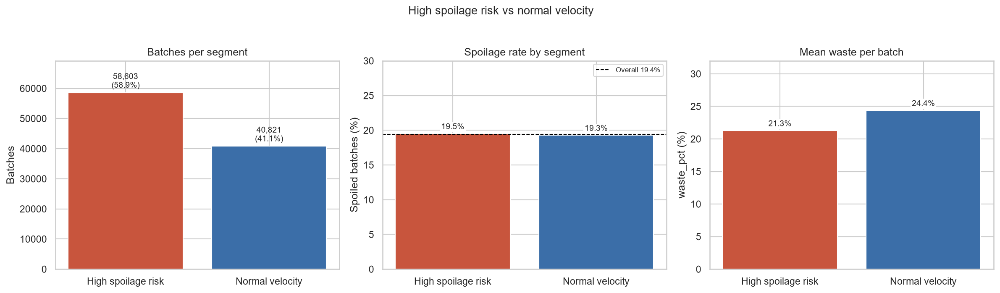
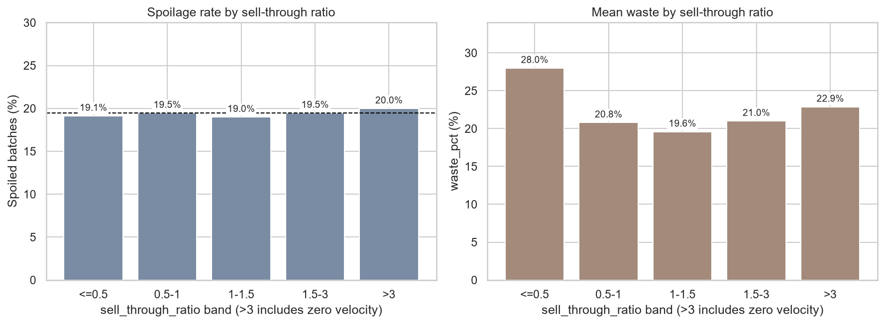
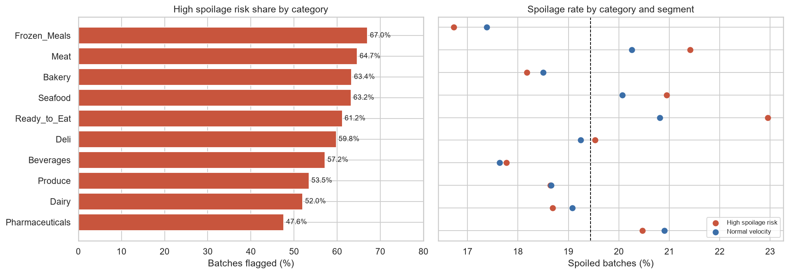
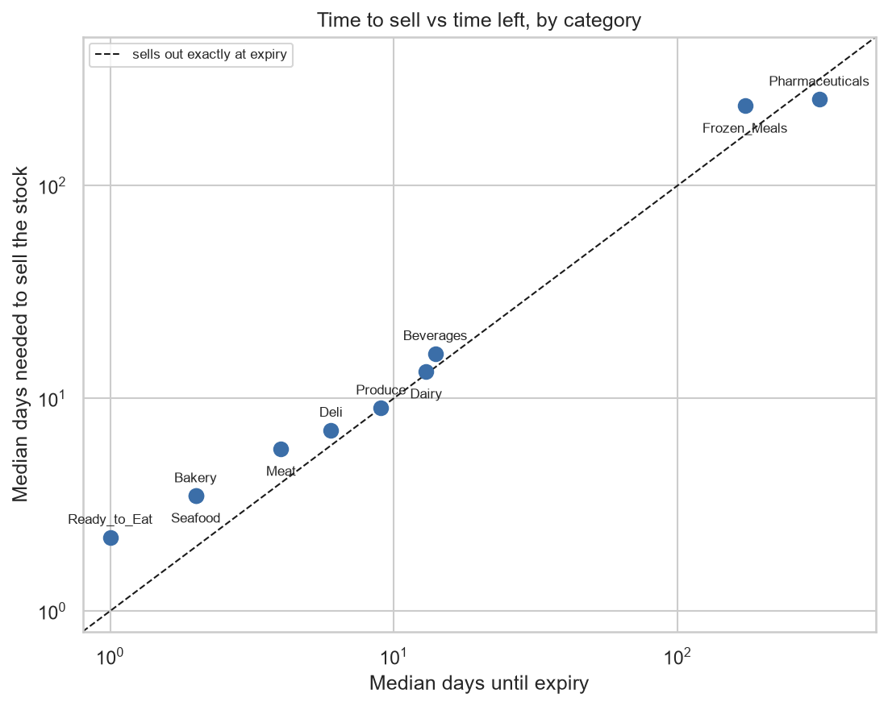
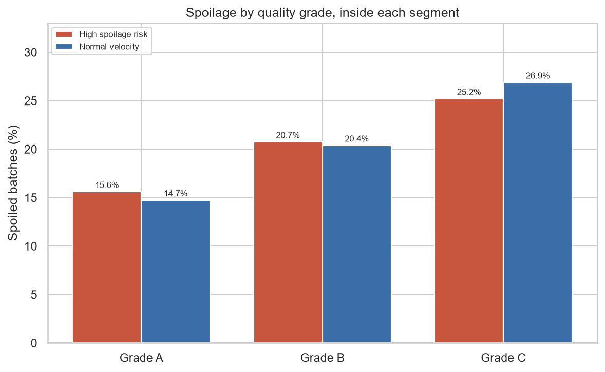
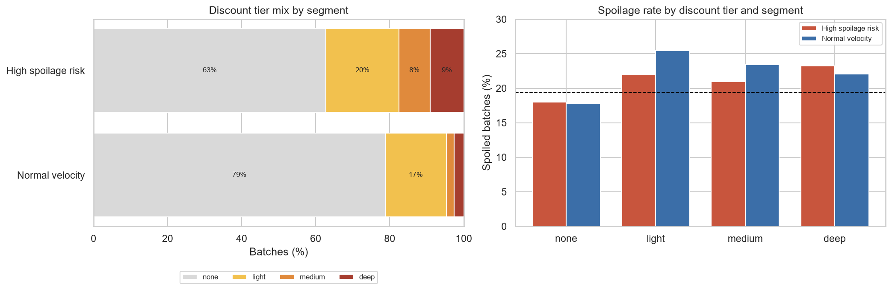
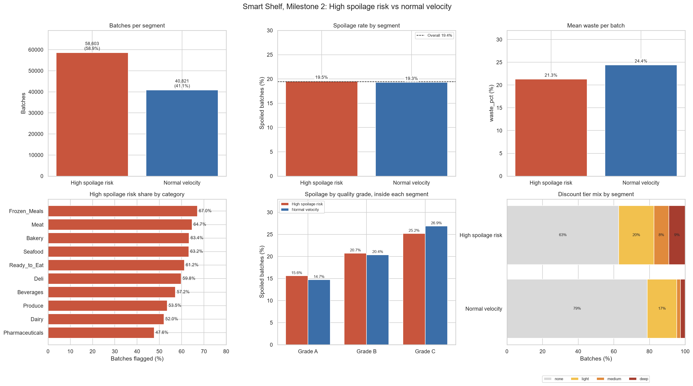

# Milestone 2: Data Analysis Report and Feature Engineering Summary

**Project:** Smart Shelf: Perishable Food Waste Reduction and Dynamic Markdown Optimizer
**Task:** M2-T05 (compiles M2-T01, M2-T02, M2-T03, M2-T04, M2-T06, M2-T07, M2-T08, M2-T10)
**Prepared by:** Malak
**Dataset:** Perishable Goods Management, 100,000 inventory batches, 10 categories, 50 stores, 5 regions, 20 suppliers, 2023-01-01 to 2024-12-31. Target: `was_spoiled` (19,442 spoiled batches, baseline rate **19.44%**).

Every number in this document is copied from the executed outputs of the Milestone 2 notebooks. Where two notebooks disagree, this is noted in Section 7.

---

## 1. Executive summary

1. **Spoilage is only weakly predictable from the pre-sale columns.** The strongest single driver is `quality_grade` (Cramér's V = 0.091). A prototype classifier reaches a holdout AUC of only 0.587, and the generated `spoilage_risk` column itself reaches 0.594 (M2-T07).
2. **Three groups of drivers matter.** `quality_grade` (spoilage rises from 15.3% in grade A to 25.9% in grade C), `packaging_score` and `handling_score` (higher scores mean less spoilage). `category` has a statistically significant but negligible effect (V = 0.039). `region`, `store_id`, `supplier_id` and `is_promoted` show no signal after multiple-testing correction (M2-T01, M2-T06).
3. **Sales velocity and sell-through risk are sell-out logic, not spoilage predictors.** 58.9% of batches are flagged as unlikely to sell out before expiry, yet they spoil at 19.5% against 19.3% for the rest (chi-square p = 0.36). Both features are mostly a category signal in this dataset (M2-T02, M2-T03, M2-T10).
4. **Stores already mark down slow stock, which creates reverse causality.** High-risk batches are discounted in 37.2% of cases against 21.2% for normal-velocity batches, and discounted batches spoil more than undiscounted ones. Discount fields are therefore treatment variables for Track 3B and are excluded from the Track 3A classifier (M2-T01, M2-T04, M2-T10).
5. **Stores do not differ in markdown habit.** The spread of store markdown rates (sd 0.0104) equals what chance alone gives (0.0103), so the store-level markdown frequency is a valid, leak-free control variable for M3-T05 but should not be expected to change results (M2-T08).
6. **Track 3B's risk input is the out-of-fold probability from Track 3A**, not `spoilage_risk`. This avoids leakage and works for a new batch in Simulator Mode (M2-T07).
7. **All new features were validated** with slow-loop recalculation and leakage tests (changing a batch's own outcome never changes its own feature value). See Section 6.

---

## 2. Data analysis report

### 2.1 Spoilage drivers (M2-T01)

**Method.** 24 tests (6 categorical, 18 numeric) against `was_spoiled`, with Holm-Bonferroni and Bonferroni correction. A factor counts as *meaningfully related* only if the Holm-adjusted p-value is below 0.05 **and** the effect size passes the small threshold (Cramér's V ≥ 0.05, η² ≥ 0.01 or |Cohen's d| ≥ 0.20). With N = 100,000, the p-value alone would flag trivial differences. `spoilage_risk` is used only as a benchmark and post-sale outcome columns are excluded.

**Categorical factors (chi-square).** Expected counts exceed 5 in every cell for all six factors.

| Factor | χ² | dof | Raw p | Cramér's V | Verdict |
|---|---|---|---|---|---|
| `quality_grade` | 821.74 | 2 | 3.6e-179 | **0.0907** | Meaningful driver (small effect) |
| `category` | 152.97 | 9 | 2.1e-28 | 0.0391 | Significant but negligible effect |
| `store_id` | 50.90 | 49 | 0.399 | 0.0226 | No signal |
| `supplier_id` | 18.19 | 19 | 0.510 | 0.0135 | No signal |
| `region` | 4.39 | 4 | 0.356 | 0.0066 | No signal |
| `is_promoted` | 0.34 | 1 | 0.559 | 0.0018 | No signal |

**Spoilage rate by level (95% Wilson intervals are in the notebook).**

| `quality_grade` | Batches | Spoilage rate |
|---|---|---|
| A | 35,665 | 15.25% |
| B | 50,037 | 20.59% |
| C | 14,298 | 25.89% |

By `category`, spoilage ranges from 16.94% (Frozen_Meals) to 22.11% (Ready_to_Eat), a gap of 5.2 percentage points. By `region` it is almost flat, 19.10% to 19.78%.

**Numeric factors (top 9 by η², Welch's t-test with Mann-Whitney U as a check).**

| Factor | Mean (spoiled) | Mean (not spoiled) | Cohen's d | η² | Holm p |
|---|---|---|---|---|---|
| `packaging_score` | 7.19 | 7.57 | -0.224 | 0.0078 | 2.3e-172 |
| `handling_score` | 6.77 | 7.05 | -0.143 | 0.0032 | 1.1e-69 |
| `shelf_life_used_ratio` | 0.176 | 0.159 | 0.112 | 0.0020 | 1.6e-37 |
| `temp_deviation` | 1.70 | 1.57 | 0.108 | 0.0018 | 5.9e-38 |
| `spoilage_sensitivity` | 0.702 | 0.682 | 0.093 | 0.0014 | 5.9e-31 |
| `distribution_hours` | 39.2 | 37.7 | 0.073 | 0.0008 | 1.1e-18 |
| `temp_abuse_events` | 0.864 | 0.786 | 0.072 | 0.0008 | 3.7e-17 |
| `expiry_remaining_ratio` | 0.624 | 0.644 | -0.071 | 0.0008 | 7.5e-17 |
| `daily_demand` | 68.8 | 63.5 | 0.057 | 0.0005 | 1.7e-10 |

No numeric factor reaches η² ≥ 0.01. `packaging_score` is the closest (η² = 0.0078) and is the only one with |d| ≥ 0.20. `storage_temp`, `demand_variability`, `supplier_score`, `initial_quantity`, `days_until_expiry`, `days_remaining_at_purchase` and `shelf_life_days` fail the corrected significance test (adjusted p ≥ 0.05).

**Quality grade and operational scores.** Tukey HSD shows that handling and packaging scores fall significantly from grade A to B to C (handling: A to C -4.00; packaging: A to C -2.99; all pairs significant). Quality grade and the two scores therefore carry related information.

**Multicollinearity (|r| ≥ 0.70 and VIF).**

| Pair | Pearson r |
|---|---|
| `days_until_expiry` and `days_remaining_at_purchase` | 0.99996 |
| `days_until_expiry` and `shelf_life_days` | 0.9917 |
| `days_remaining_at_purchase` and `shelf_life_days` | 0.9918 |
| `base_price` and `cost_price` | 0.9860 |

VIF is above 10 only for these five columns (`days_remaining_at_purchase` 20,227; `days_until_expiry` 20,203; `shelf_life_days` 68.4; `base_price` 37.2; `cost_price` 35.9). Every other numeric factor is below 3.1.

**Benchmark: `spoilage_risk` deciles.** The observed spoilage rate rises steadily from 11.1% in decile 1 to 28.9% in decile 10, closely tracking the mean predicted risk (11.3% to 28.8%). The correlation with `was_spoiled` is only r = 0.131.

**Robustness.**
- *Temporal stability:* chronological 70/30 split at 2024-05-26 (70,000 / 30,000 batches). Cramér's V for `quality_grade` is 0.089 and 0.094, for `category` 0.041 and 0.041, and for `region` 0.011 and 0.010, so the associations are stable over time.
- *Permutation null (1,000 shuffles):* false-positive rates of 5.5% (category), 5.4% (packaging) and 4.9% (handling) match the nominal 5%.

**Discount fields (descriptive only).** `markdown_applied == (discount_pct > 0)` holds in all 100,000 rows. `discount_pct` correlates positively with spoilage (r = +0.0466), which reflects reverse causality: stores discount batches that are close to expiry.

### 2.2 Time to sell versus time left, and the High Spoilage Risk segmentation (M2-T03, M2-T10)

`sell_through_risk` is the number of days needed to sell the stock at the speed of earlier batches. A batch is **High spoilage risk** when it would not sell out before expiry (`sell_through_ratio > 1`, or zero velocity with stock in hand). All other batches with a velocity are **Normal velocity**. The 576 batches with no earlier data (first days of the file) have no flag and are left out. 99,424 batches are segmented.

| | High spoilage risk | Normal velocity |
|---|---|---|
| Batches | 58,603 (58.9%) | 40,821 (41.1%) |
| Spoilage rate | 19.54% | 19.30% |
| Mean waste % | 21.31 | 24.41 |
| Median stock (units) | 338 | 130 |
| Median velocity (units/day) | 29.7 | 31.0 |
| Median days until expiry | 5 | 10 |
| Markdown rate | 37.23% | 21.23% |
| Mean discount when marked | 35.24% | 27.30% |
| Deep discount (>50%) share | 9.13% | 2.62% |

**Findings.**
- The two segments spoil at nearly the same rate (chi-square p = 0.357). The segmentation says how likely a batch is to remain *unsold*, not how likely it is to *spoil*.
- For a typical batch, the time needed to sell the stock is close to the time left before expiry (points sit near the diagonal in Figure 4), so the rule "ratio > 1" is coarse and flags almost 59% of batches. The ratio is better used as a graded score.
- Spoilage stays between 19.0% and 20.0% in every ratio band (`<=0.5`: 19.13%; `0.5-1`: 19.47%; `1-1.5`: 19.00%; `1.5-3`: 19.48%; `>3`: 19.99%).
- Waste percentage runs the "wrong" way (lower in the high-risk segment). The likely cause is batch size: the ratio grows with stock, and larger batches waste a smaller share (correlation of stock with `waste_pct` = -0.137).
- The high-risk share by category ranges from 47.6% (Pharmaceuticals) to 67.1% (Frozen_Meals). Inside each category the two segments spoil at similar rates, so category matters more than segment.
- Quality grade separates spoilage far more than the segment does, in both segments: grade A 15.6% (high risk) and 14.7% (normal), grade C 25.2% and 26.9%.

### 2.3 Discounts and markdowns (M2-T04, M2-T10)

| Tier | Discount range | Batches | Share |
|---|---|---|---|
| none | 0% | 69,349 | 69.3% |
| light | 10% to 30% | 18,403 | 18.4% |
| medium | 30% to 50% | 5,805 | 5.8% |
| deep | above 50% | 6,443 | 6.4% |

The M1-T02 result is confirmed: every batch with a markdown has a discount and every batch with a discount has a markdown (discount range 0.10 to 0.75). High-risk batches are discounted much more often and more deeply (Section 2.2 table). Undiscounted batches spoil least in both segments (about 18%), while discounted tiers sit at about 21% to 26%. This is the opposite of a markdown helping: stores discount the batches they already expect to spoil. This is the reverse-causality concern behind the Track 3B design.

### 2.4 Stores and markdown habit (M2-T08)

- Store markdown rates run from 28.6% to 33.2% (overall 30.7%). The spread (sd 0.0104) equals the spread expected from chance alone (0.0103).
- Chi-square test of equal markdown rate across the 50 stores: p = 0.45, Cramér's V = 0.022. After removing each store's category mix: p = 0.277, with 3 stores beyond ±2 standard errors against 2 to 3 expected by chance.
- The feature carries essentially no information about the batch's own markdown (AUC 0.501, correlation 0.003 to 0.004, also inside categories). This is the expected result of a clean no-lookahead feature.
- With few earlier batches, the raw rate is noisy (mean distance of 0.19 from the store's final rate with 10 or fewer earlier batches); the smoothed version cuts this to 0.04.

### 2.5 Promotion and quality signals (M2-T06)

- Spoilage by `packaging_score` falls from 24.6% (score 5) to 14.5% (score 10). By `handling_score` it falls from 22.8% (score 4) to 16.1% (score 10).
- `temp_abuse_events` is a small risk driver (r = +0.0287). It is a right-skewed count (skew 1.67, 7.8% IQR outliers); the large values (up to 10) are valid and kept, and `log1p` reduces the skew to 0.68.
- `supplier_score` shows no signal (r = +0.0029, p = 0.36; spoilage stays between 19.3% and 19.7% at every score).
- `is_promoted` (14.9% of batches) is nearly independent of markdown (correlation -0.002) and of spoilage (19.41% against 19.62%).
- `spoilage_sensitivity` is constant within each category (R² = 1.0, 9 distinct values), so it is redundant with `category`.

### 2.6 Design decision: risk input for Track 3B (M2-T07)

Track 3B uses Track 3A's **out-of-fold (OOF) predicted spoilage probability** as its risk input, not the `spoilage_risk` column.

| Evidence | Result |
|---|---|
| AUC of `spoilage_risk` alone | 0.594 |
| Share of `spoilage_risk` rebuilt from input columns (out-of-fold R²) | 99.6% |
| AUC of the part the inputs cannot rebuild | 0.515 (almost no outcome information) |
| Flexible random forest, in-sample vs holdout AUC | 1.000 vs 0.554 (ordinary predictions on training rows are over-optimistic) |
| Prototype: in-sample / OOF / holdout AUC | 0.608 / 0.586 / 0.587 |
| Correlation of OOF probability with `spoilage_risk` | 0.904 (training), 0.909 (holdout) |

**Reasons.** `spoilage_risk` is tied to the process that generates `was_spoiled` and does not exist for a new batch in Simulator Mode. The classifier rebuilds its information from pre-sale columns, so nothing is lost.

**How the OOF predictions are produced.** The training rows (up to 2024-08-07, 80,042 rows) are split into 5 stratified, shuffled folds. Each fold is predicted by a model trained on the other four, so every training row gets exactly one probability from a model that never saw it. The loop matches scikit-learn's `cross_val_predict`. A new batch in Simulator Mode is scored by the final classifier (`predict_proba`).

**Scheme comparison (OOF AUC against holdout AUC 0.5874).** Stratified 5-fold 0.5859, stratified 10-fold 0.5863, time-blocked 5-fold 0.5870, grouped by product and store 0.5868 (all within 0.002 of the holdout). The expanding window (0.5829) leaves 20% of rows without a probability and was rejected. **Decision: stratified, shuffled 5-fold.** **Re-check rule for M3-T04:** repeat the comparison with the tuned classifier; if the OOF and holdout AUC differ by more than 0.01, switch to time-blocked folds.

### 2.7 Figures (M2-T10)

*Figure 1. High spoilage risk (58.9%) and Normal velocity (41.1%) spoil at almost the same rate (19.5% against 19.3%), while the high-risk segment loses less per batch.*

*Figure 2. Spoilage stays between 19.0% and 20.0% in every ratio band. The lowest band has the highest waste because it holds the smallest batches.*

*Figure 3. The high-risk share ranges from 47.6% (Pharmaceuticals) to 67.1% (Frozen_Meals); category matters more than segment for spoilage.*

*Figure 4. For every category, the median time needed to sell the stock is close to the time left before expiry.*

*Figure 5. Quality grade drives spoilage in both segments (grade A about 15%, grade C about 25% to 27%).*

*Figure 6. The high-risk segment is discounted more often (37.2% against 21.2%) and more deeply (9.1% deep discounts against 2.6%).*

*Figure 7. One-page dashboard combining the six panels that carry the story.*

Supporting tables are in `reports/tables/` (`M2_T04_discount_tier_summary.csv`, `M2_T10_segment_summary.csv`, `M2_T10_category_segments.csv`, `M2_T10_ratio_bands.csv`, `M2_T10_grade_by_segment.csv`).

---

## 3. Feature engineering summary

### 3.1 Feature table

All features use only information known when the batch arrives, or earlier batches. None is built from `units_sold`, `units_wasted`, `waste_pct`, `revenue`, `profit` or other post-sale outcomes for the batch itself.

| Feature | Task | Formula | Columns used | Empty values | Expected impact |
|---|---|---|---|---|---|
| `remaining_shelf_life_ratio` | M2-T02 | `days_until_expiry / shelf_life_days`, clipped to [0, 1] | `days_until_expiry`, `shelf_life_days` | 0 | Weak protective signal (AUC 0.481). Same values as `expiry_remaining_ratio` from M1-T04, so do not use both. |
| `remaining_ratio_at_purchase` (extra) | M2-T02 | `days_remaining_at_purchase / shelf_life_days`, clipped to [0, 1] | `days_remaining_at_purchase`, `shelf_life_days` | 0 | Weak (AUC 0.474); second version for M3 to test. |
| `sales_velocity` | M2-T02 | Sum of `units_sold` of earlier batches of the same `product_name` in the same store in the previous 7 days, divided by 7. Fallback: same category and store, earlier days, divided by days since the group's first record (at least 7). | `units_sold`, `product_name`, `store_id`, `category`, `transaction_date` | 576 (`no_history`) | No stand-alone spoilage signal (AUC 0.503). Not in units per day (see below). |
| `sales_velocity_per_day` (extra) | M2-T02 | Mean of `units_sold / days_remaining_at_purchase` over the same earlier batches, same fallback | as above plus `days_remaining_at_purchase` | 576 | AUC 0.513. Correlates 0.479 with `daily_demand`. Used for stock-over-velocity calculations. |
| `velocity_source`, `batches_in_window_7d` | M2-T02 | Which rule produced the value; number of earlier batches behind it | | 0 | Traceability. 74.0% category-store fallback, 25.4% own window, 0.6% no history. |
| `current_stock` | M2-T03 | `initial_quantity` | `initial_quantity` | 0 | Stock source; never derived from `units_sold` or `units_wasted`. |
| `sell_through_risk` | M2-T03 | `current_stock / sales_velocity_per_day` (days needed to sell the stock) | `current_stock`, `sales_velocity_per_day` | 2,603 (576 no history + 2,027 zero velocity) | Sell-out logic input for M3. |
| `sell_through_ratio` | M2-T03 | `sell_through_risk / max(days_until_expiry, 1)`, capped at 10 | plus `days_until_expiry` | 576 | AUC 0.505 (no spoilage signal alone). Better used as a graded score. |
| `at_risk` / `risk_status` | M2-T03 | 1 where ratio > 1. Zero velocity with stock = `at_risk_zero_velocity`. No earlier data = `no_history`, no flag. | as above | 576 | Flags 58.9% of batches with a velocity; coarse flag. |
| `markdown_flag` | M2-T04 | `markdown_applied` | `markdown_applied` | 0 | Excluded from Track 3A. For Track 3B see the note in Section 4. |
| `discount_depth` | M2-T04 | `discount_pct` rounded to 2 decimals | `discount_pct` | 0 | Excluded from Track 3A. For Track 3B see the note in Section 4. |
| `discount_tier`, `is_light`, `is_medium`, `is_deep` | M2-T04 | none (0%), light (10 to 30%), medium (30 to 50%), deep (above 50%); one-hot indicators | `discount_pct` | 0 | Excluded from Track 3A. For Track 3B see the note in Section 4. Counts: 69,349 / 18,403 / 5,805 / 6,443. |
| `temp_abuse_events` (prepared) | M2-T06 | `log1p`, then `StandardScaler` (fitted on the training period only) | `temp_abuse_events` | 0 | Small risk driver (r = +0.0287). Keep for Track 3A. |
| `handling_score` (prepared) | M2-T06 | `StandardScaler` | `handling_score` | 0 | Protective (r = -0.0563). Keep for Track 3A. |
| `packaging_score` (prepared) | M2-T06 | `StandardScaler` | `packaging_score` | 0 | Strongest numeric signal (r = -0.0885). Keep for Track 3A. |
| `supplier_score` (prepared) | M2-T06 | `StandardScaler` | `supplier_score` | 0 | No signal (r = +0.0029, p = 0.36). Prepared as required; not recommended for the final set. |
| `spoilage_sensitivity` (prepared) | M2-T06 | `StandardScaler`; cleared in M1-T06 | `spoilage_sensitivity` | 0 | Redundant with `category` (R² = 1.0). Not recommended next to `category`. |
| `is_promoted` | M2-T06 | Carried forward as its own 0/1 column, not merged into the discount flags | `is_promoted` | 0 | No spoilage signal (null for Track 3A). Kept as a confounder for the M3-T05 check. |
| `store_md_freq_hist` | M2-T08 | Markdown batches of the store on strictly earlier days / all batches of the store on strictly earlier days | `store_id`, `transaction_date`, `markdown_applied` | 152 | Control variable for M3-T05; AUC 0.501 against the batch's own markdown. |
| `store_md_freq_smoothed` | M2-T08 | `(markdowns_before + 20 * global_rate_before) / (n_before + 20)` | as above | 148 | Safer when a store has little history (1.1% of rows have fewer than 20 earlier batches). |
| `store_md_prior_n`, `store_md_freq_90d`, `store_md_freq_finished` | M2-T08 | Earlier batch count; last 90 days only; only earlier batches that had already expired | as above plus `expiration_date` | 0 / 152 / 552 | Support and robustness columns. `store_md_freq_finished` is not a drop-in replacement (mean 0.340 against 0.306; correlation 0.55). |
| `sell_through_ratio_dist`, `at_risk_dist` (optional) | M2-T03 | Same ratio with `days_until_expiry - distribution_hours / 24` (at least 1) | plus `distribution_hours` | 576 | Changes 7.4% of flags (at-risk share 58.9% to 66.4%) with no useful gain (AUC +0.0025). Official `at_risk` unchanged. |

### 3.2 Rules that apply to every velocity and history feature

1. **Earlier days only.** "Before" means strictly earlier dates. The batch itself and all same-day batches are excluded because the order inside a day is unknown.
2. **No history stays empty, never 0.** A value of 0 would claim "this product never sells" or "this store never marks down". M3 should drop these rows or fill them with the training all-store rate.
3. **Product-store pair = `product_name` x `store_id`.** `product_id` has 45,301 distinct values, giving 97,984 pairs with about one row each, so no history would ever exist. `product_name` gives 3,150 pairs with about 32 rows each.
4. **An empty 7-day window uses the fallback.** About 74% of pair windows are empty. Treating them as velocity 0 would wrongly say the product does not sell.
5. **`sales_velocity` is not units per day.** `units_sold` is the batch total over its whole shelf life (a Frozen_Meals batch sells 137 units over about 200 days; a Ready_to_Eat batch sells 220 in 3 days). This is why `sales_velocity_per_day` is the main velocity for sell-through risk.
6. **The 0 to 3 day lag in `days_until_expiry`** (74,191 rows differ from the date gap) was tested for leakage: the lag has the same spread for spoiled and unspoiled batches and no correlation with distribution hours, handling, temperature abuse events or supplier score. The official ratio therefore uses `days_until_expiry`, as the task card says.

### 3.3 Recommended feature set for Track 3A (from M2-T01 and M2-T06)

| Decision | Features | Reason |
|---|---|---|
| **Keep** | `quality_grade`, `category`, `packaging_score`, `handling_score`, `shelf_life_used_ratio`, `temp_deviation`, `temp_abuse_events`, `distribution_hours`, `daily_demand`, `expiry_remaining_ratio` (equivalent to `remaining_shelf_life_ratio`), `initial_quantity`, `days_until_expiry`, `base_price` | Pre-sale physical, handling and operational signals. Only `quality_grade` passes both the significance and effect-size rule; the others are individually weak and are kept for combined modeling. |
| **Drop (redundant or collinear)** | `spoilage_sensitivity`, `days_remaining_at_purchase`, `shelf_life_days`, `cost_price` | Redundant with `category`, or correlated at 0.986 or more with a kept column. |
| **Drop (no signal)** | `region`, `store_id`, `supplier_id`, `is_promoted`, `demand_variability`, `supplier_score`, `storage_temp` | Adjusted p ≥ 0.05 and no measurable effect. |
| **Excluded by rule** | `spoilage_risk`, post-sale outcomes (`units_sold`, `units_wasted`, `waste_pct`, `revenue`, `waste_cost`, `profit`, `profit_margin_pct`), `markdown_applied`, `discount_pct`, `selling_price` | Benchmark only, post-sale information, or treatment variables reserved for Track 3B. |

The final feature set is decided in M3-T02.

### 3.4 Expected impact summary

No single engineered feature predicts spoilage on its own (all AUCs between 0.47 and 0.52). The realistic expectation for Milestone 3 is a spoilage classifier with an AUC near 0.59, driven mainly by `quality_grade`, `packaging_score` and `handling_score`. The velocity, sell-through and markdown features serve the sell-out logic, the Track 3B revenue and discount model, and the M3-T05 confounding check rather than the classifier.

---

## 4. Track assignments of the new features

| Track | Uses |
|---|---|
| **Track 3A** (spoilage classifier) | Keep list in Section 3.3. Out-of-fold predictions are produced from this model. |
| **Track 3B** (revenue and discount model) | Out-of-fold spoilage probability as the risk input; `discount_pct` as the discount input; `sell_through_risk`, `sell_through_ratio` and `at_risk` for sell-out logic. |
| **M3-T05** (confounding check) | `is_promoted`, `store_md_freq_hist` (or `store_md_freq_smoothed`), always together with `category`. |

**Note on discount inputs.** The team repo rules say that for Track 3B `discount_pct` is the only discount input. The M2-T04 columns (`markdown_flag`, `discount_depth`, `discount_tier` and the one-hot tiers) are all derived from `discount_pct`. They are used in this report for description and segmentation. The team should confirm whether any of them may also enter the Track 3B model as extra inputs.

---

## 5. Hand-off for the Milestone 3 modeling team

- Join all feature files to the cleaned dataset on `record_id`. Feature files are saved in `data/processed/` and are not committed (`.gitignore` excludes `*.csv`); each notebook recreates its file.
- Fill or drop empty rows as described in Section 3.2.
- State which shelf-life version each model uses (team rule). `expiry_remaining_ratio` (equal to `remaining_shelf_life_ratio`) and `shelf_life_used_ratio` are both on the M2-T01 keep list (correlation -0.45), so the final model must say which one it uses, or justify using both.
- In deployment, count only finished batches (or live sales and live markdown history) in the velocity and store-markdown features, because `units_sold` is a batch's final total. In this dataset about 78% of a 7-day window's sales come from batches that had not finished selling. The within-category correlation between this velocity and the current batch's own selling speed is 0.007 (0.002 for `units_sold`), so no information about the current batch passes through, and the feature does not distort this dataset.

---

## 6. Validation summary

| Task | Checks performed | Result |
|---|---|---|
| M2-T01 | Chi-square assumptions; Holm and Bonferroni; chronological 70/30 stability; 1,000-shuffle permutation null; VIF and correlation screening | All assumptions met; permutation false-positive rates 4.9% to 5.5% |
| M2-T02 | 300 random rows recalculated with a plain loop; leakage test (set one batch per category-store group to 1,000,000 units); row and key checks | 0 mismatches; 0 own-value changes; 35,561 other batches changed (the test is sensitive) |
| M2-T03 | 500 rows recalculated by hand; flag equals "ratio > 1" exactly; leakage test on `units_sold` and `units_wasted`; row and key checks | All match; 0 own-value changes |
| M2-T04 | Cross-check of markdown and discount; one-hot tiers sum to `markdown_flag`; range checks | All checks passed |
| M2-T06 | Scaler fitted on training period only (up to 2024-08-07); no drift between periods | Training mean 0 and standard deviation 1 for every scaled column; test means within ±0.005 |
| M2-T07 | Every training row predicted exactly once; loop equals `cross_val_predict`; calibration curve | All pass |
| M2-T08 | 400 rows recalculated with a plain loop; leakage test that flips the markdown of every batch of one store-day per store | 0 mismatches; 0 own-value changes; 43,468 later batches changed |
| M2-T10 | Segment counts rebuilt and compared with M2-T02 and M2-T03 | Identical: 56,576 `at_risk`, 2,027 `at_risk_zero_velocity`, 40,821 `ok`, 576 `no_history` |

---

## 7. Deviations from plan and open items

### 7.1 Deviations from plan

- **M2-T02.** The product-store pair uses `product_name` x `store_id` instead of `product_id` x `store_id` (`product_id` gives about one row per pair). An empty 7-day window uses the category-store fallback instead of velocity 0. Added extra columns: `remaining_ratio_at_purchase`, `sales_velocity_per_day`, `velocity_source`, `batches_in_window_7d`.
- **M2-T03.** The main velocity is `sales_velocity_per_day`, not the card's raw `sales_velocity`, because the raw velocity is not in units per day (it would flag 41.1% of batches and agree with the main flag on only 72.9% of rows). Zero velocity with stock is flagged `at_risk_zero_velocity` (ratio capped at 10), and `days_until_expiry = 0` is counted as 1 day. The optional `distribution_hours` enrichment was tried and kept as separate columns; it does not change the official flag.
- **M2-T06.** `supplier_score` and `spoilage_sensitivity` were prepared as the task requires but are not recommended for the final Track 3A set (no signal, and redundant with `category`).
- **M2-T08.** Added a smoothed version (K = 20), a 90-day version and a strict "finished batches only" version next to the main feature.
- **M2-T10.** The task card does not define "High Spoilage Risk" and "Normal Velocity", so the segmentation uses the M2-T03 `at_risk` flag (zero velocity included). Figures are static PNG files; interactive Plotly versions were not built. The velocity and sell-through functions were added to `src/m2_velocity.py`.
- **M2-T01, M2-T04 and M2-T07.** No deviations reported.

### 7.2 Inconsistencies between notebooks

These are small inconsistencies found while compiling this report. This document uses the executed notebook outputs.

1. **Chronological split size (M2-T01).** The written conclusion states 70,077 / 29,923 batches; the executed output is 70,000 / 30,000 (split date 2024-05-26).
2. **Keep list versus verdict column (M2-T01).** `days_until_expiry` and `initial_quantity` are labelled "drop (null signal)" in the verdict table, while the synthesis keeps them (`days_until_expiry` as the representative of the collinear group and as an input to M2-T03; `initial_quantity` as batch size and `current_stock`). Likewise the keep list includes factors whose own verdict is "weak". The final set is to be settled in M3-T02.
3. **Effect-size rule (M2-T01).** `packaging_score` fails η² ≥ 0.01 (0.0078) but passes |d| ≥ 0.20 (0.224). The verdict logic used η² only.
4. **VIF note (M2-T01).** The notes column says VIF above 20,000 for all three expiry and shelf-life columns, but `shelf_life_days` has VIF 68.4 (its correlation is above 0.99).
5. **Mutual information (M2-T01).** `region_Northeast` ranks 4th in mutual information, even though the chi-square test shows no region effect. All MI values are 0.010 or lower, which is noise level.
6. **At-risk spoilage rate (M2-T03 and M2-T10).** The M2-T03 text says 19.5% for flagged batches, while its table shows 19.6% for the `at_risk` status alone. M2-T10 reports 19.54% for the full High spoilage risk segment (zero-velocity batches included). This report uses 19.5%.
7. **Distribution hours (M2-T06 and M2-T03).** The M2-T06 notebook says the `distribution_hours` enrichment was not tried, but M2-T03 Section 7 tried it. This report follows M2-T03.
8. **`feature_dictionary.csv`.** It still lists `spoilage_sensitivity` as "hold until M1-T06"; it should be updated to the M1-T06 verdict ("allowed").
9. **Interactive charts.** M2-T10 delivers static PNG figures only; interactive Plotly versions were not built.
