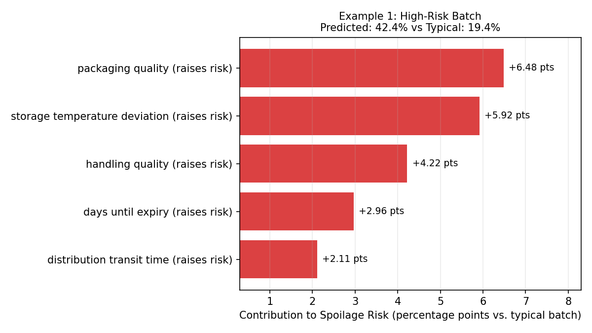
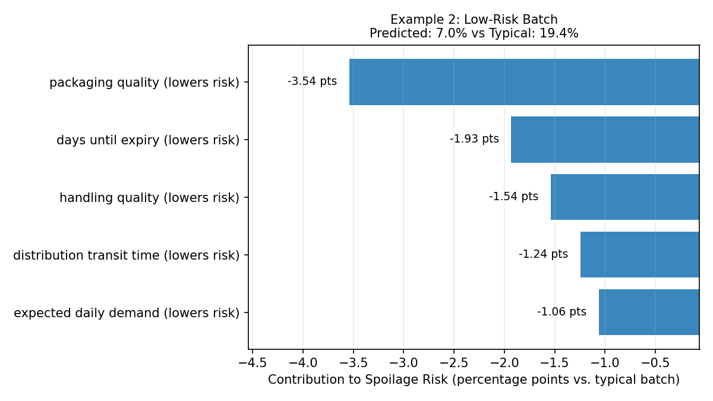
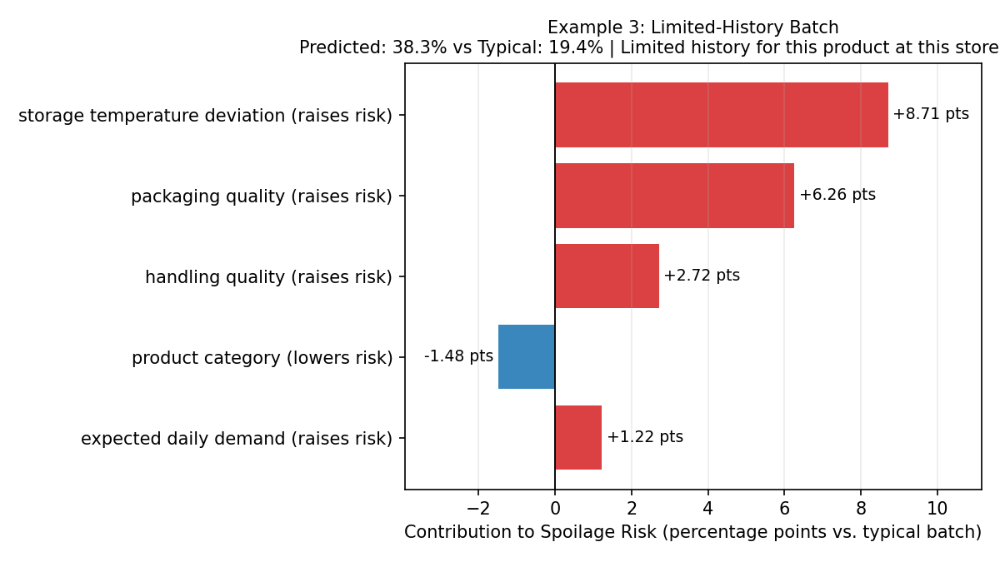

# M3-T03: Track 3A Per-Batch Explainability & Limited-History Flag Report

**Task:** M3-T03 — Per-Batch SHAP/Linear Explanations & Support Flag  
**Branch:** `M3-T03-shap-explainability-confidence-flag`  
**MLflow Experiment:** `smart-shelf-3a-spoilage-classifier` (Validation Run ID: `b5b3d48246284a5985602266859d60c4`)  
**Frozen Model:** Regularized Logistic Regression (`C=0.005`, `l2`, uncalibrated) on `TRACK_3A_FEATURES_COMPACT` (90 features)

---

## 1. Feature Audit (`TRACK_3A_FEATURES_COMPACT`, 90 Features)

| Requested Signal | In Frozen COMPACT? | Exact Column Name(s) | Notes |
| :--- | :---: | :--- | :--- |
| `temp_abuse_events` | **Yes** | `temp_abuse_events` | Present (z-scored in M2). |
| `handling_score` | **Yes** | `handling_score` | Present (z-scored in M2). |
| `packaging_score` | **Yes** | `packaging_score` | Present (z-scored in M2). |
| `temp_deviation` | **Yes** | `temp_deviation` | Present (standardized in M1). |
| `days_until_expiry` | **Yes** | `days_until_expiry` | Present (standardized in M1). |
| `expiry_remaining_ratio` | **Yes** | `expiry_remaining_ratio` | Present (in `[0, 1]`). |
| `quality_grade` | **Ordinal** | `quality_grade_ord` | Encoded as ordinal numeric (`0..3`). |
| `supplier_score` | **No** | — | Intentionally pruned in `COMPACT` (M2-T11). |

Both `temp_abuse_events` and `handling_score` are present in the frozen model, so no fallback proxies are needed for those signals.

---

## 2. Method

1. **Exact Linear Decomposition:** Because the frozen model is a linear logistic regression ($\text{logit}(p(x)) = \beta_0 + \sum_j \beta_j x_j$), each feature's exact log-odds contribution relative to the training-partition mean $\mu_j$ (`N = 80,042`) is:
   $$\phi_j(x) = \beta_j (x_j - \mu_j)$$
   Summing $\phi_j(x)$ over all 90 features equals $\text{logit}(p(x)) - \text{base\_logit}$ exactly.
2. **Human-Readable Grouping:** One-hot and cyclical columns are summed into single drivers (`category_*` → `category`, `product_name_*` → `product_name`, `month_sin`/`month_cos` → `seasonality_month`, `dow_sin`/`dow_cos` → `day_of_week`) and mapped to plain-language labels via `PLAIN_NAME_MAP` in `src/m3_t03_explain.py`.
3. **Probability-Point Allocation:** Grouped log-odds contributions are converted to percentage points ($\text{pts}$) via proportional allocation of the total probability shift:
   $$\Delta p_{\text{group}} = (p(x) - p_{\text{ref}}) \times 100 \times \frac{\phi_{\text{group}}}{\text{logit}(p(x)) - \text{base\_logit}}$$
   so grouped percentage-point contributions sum to $(p(x) - p_{\text{ref}}) \times 100$ (with $p_{\text{ref}} = 19.36\%$, the mean predicted probability on the training reference).
4. **Limited-History Support Flag:** Reuses `compute_support` and `flag_low_confidence` from `src/support.py` (`product_name × store_id`, threshold `< 20` training rows), attaching `low_history_flag`, `history_rows`, and the UI wording `"Limited history for this product at this store"`.

---

## 3. Validation Results

### 3.1 Sum-to-Logit Exactness (N = 1,000 Test Sample)
- **Max $|\sum \phi_j - (\text{logit}(p) - \text{base\_logit})|$:** **`4.441e-16`** (passes `< 1e-6` tolerance to machine precision).
- **Max probability-point sum error:** **`1.260e-13`** pts.

### 3.2 Global Consistency vs. M3-T01 SHAP Ranking (N = 2,000 Test Sample)

| Rank (Grouped, M3-T03) | Driver | Mean \|Log-Odds\| | M3-T01 Rank (Ungrouped `LinearExplainer`) |
| :---: | :--- | :---: | :---: |
| 1 | `packaging_score` | 0.1919 | #1 (`0.1917`) |
| 2 | `handling_score` | 0.1203 | #2 (`0.1214`) |
| 3 | `days_since_receipt` | 0.0840 | #4 (`0.0798`) |
| 4 | `days_until_expiry` | 0.0818 | #3 (`0.0801`) |
| 5 | `temp_deviation` | 0.0702 | #5 (`0.0714`) |
| 6 | `distribution_hours` | 0.0644 | #6 (`0.0651`) |
| 7 | `daily_demand` | 0.0528 | #7 (`0.0524`) |
| 8 | `category` (summed 10 one-hots) | 0.0413 | — (split across 10 one-hots) |
| 9 | `base_price` | 0.0336 | #8 (`0.0335`) |
| 10 | `initial_quantity` | 0.0299 | #9 (`0.0299`) |

**Rank differences explained:** `days_since_receipt` and `days_until_expiry` were virtually tied in M3-T01 (`0.0798` vs `0.0801`) and swap #3/#4 when using the full 80,042-row training mean instead of a 2,000-row background sample. `category` enters at #8 (`0.0413`) because summing its 10 one-hot indicators aggregates category risk into one driver.

### 3.3 Stability
- Repeated `explain_batch()` calls and single-row vs. batched calls produced **bit-for-bit identical** outputs.

---

## 4. Sanity Examples (Test Partition)

1. **High-Risk Batch (`record_id=61556`, `Crab` at `STORE_036`, `history_rows=22`):**  
   > Predicted spoilage risk 42.4% (typical batch: 19.4%). Main drivers: packaging quality raises risk (+6.5 pts), storage temperature deviation raises risk (+5.9 pts), handling quality raises risk (+4.2 pts).  
   

2. **Low-Risk Batch (`record_id=40477`, `Frozen Desserts` at `STORE_021`, `history_rows=32`):**  
   > Predicted spoilage risk 7.0% (typical batch: 19.4%). Main drivers: packaging quality lowers risk (-3.5 pts), days until expiry lowers risk (-1.9 pts), handling quality lowers risk (-1.5 pts).  
   

3. **Limited-History Batch (`record_id=210`, `Cakes` at `STORE_025`, `history_rows=18`):**  
   > Predicted spoilage risk 38.3% (typical batch: 19.4%). Main drivers: storage temperature deviation raises risk (+8.7 pts), packaging quality raises risk (+6.3 pts), handling quality raises risk (+2.7 pts). Note: Limited history for this product at this store (18 training rows).  
   

---

## 5. Limitations & Calibration Context

- **Modest Risk Spread & AUC Ceiling:** Track 3A's test ROC-AUC is **0.5899** (near the dataset's structural ~0.59–0.60 ceiling), and predicted probabilities mostly span **0.12–0.28** (5th–95th percentile). Even "high-risk" batches are only modestly above the ~19.4% base rate, so explanation text must never claim high certainty.
- **Support Flag Calibration Finding:** As measured in M2-T12 (`reports/M2/M2_T12_Decision_Checks.md`), flagged (`< 20` training rows) and unflagged test rows show **no meaningful calibration difference** (Brier score difference `-0.00343`, 95% bootstrap CI `[-0.01187, +0.00568]`). The flag strictly communicates sparse product–store training history (`"Limited history for this product at this store"`), not lower model accuracy.

---

## 6. Deviations from Plan

1. **Support Flag Key (`product_name × store_id` vs. Notion's `category × region × store`):** As documented in M2-T12b (`M2_T11_M3_Design_Decisions.md` Decision #5), the original proposal/Notion key `category × region × store` never triggered (all 500 cells had $\ge 129$ training rows). We use `product_name × store_id` (threshold 20, flagging `14.36%` of test rows).
2. **Exact Linear Decomposition vs. `TreeExplainer`:** Because the frozen Track 3A model is regularized logistic regression rather than a tree model, `explain_batch()` uses exact linear log-odds decomposition against the full 80,042-row training mean rather than `shap.TreeExplainer`.
