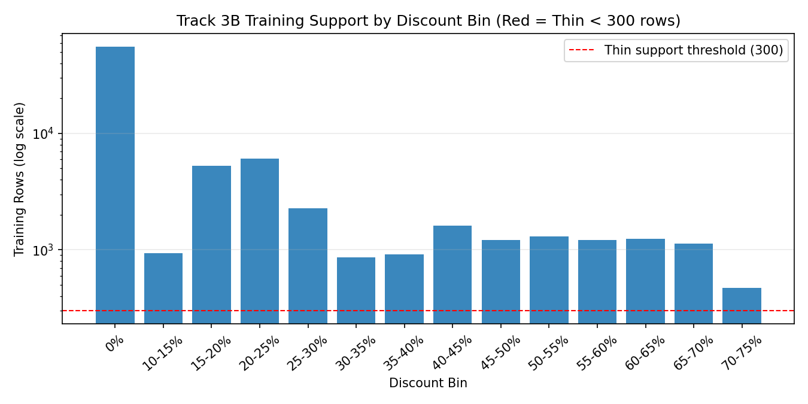
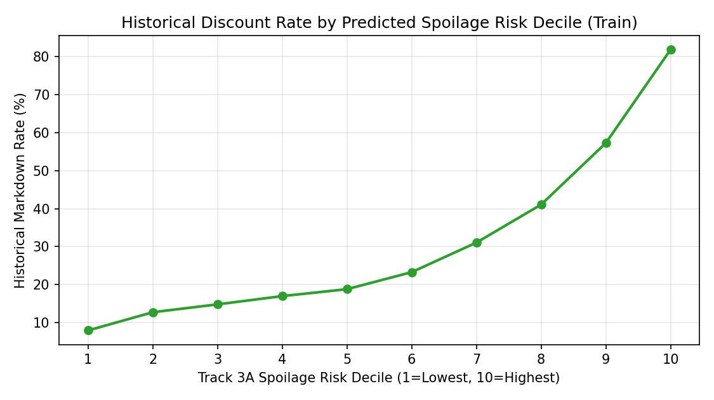
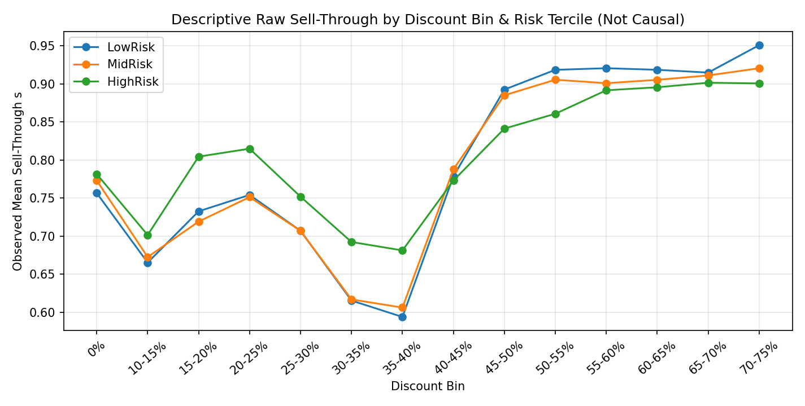

# M3-T04: Track 3B Scenario Construction & Overlap Diagnostics Report

**Task:** M3-T04 — Track 3B Training Set & Overlap Diagnostics  
**Branch:** `M3-T04-scenario-construction`  
**MLflow Experiment:** `smart-shelf-3b-revenue-response` (Run ID: `486dd40b3dfc4baa898d80b8b81453a5`)  
**Dataset Generated:** `data/processed/model_ready_3b_dataset.csv` (`100,000 × 59`, gitignored)

---

## 1. Dataset Description & Feature Audit

`build_3b_dataset()` in `src/m3_t04_scenario.py` assembles 100,000 rows (`80,042` train `<= 2024-08-07`, `19,958` test `> 2024-08-07`):
- **Identifiers & Split:** `record_id`, `transaction_date`, `split`
- **Model Features (`TRACK_3B_FEATURES`, 43 scaled/encoded columns):**
  - Treatment: `discount_pct`
  - Confounding controls: `days_until_expiry`, `quality_grade_ord`, `sales_velocity`, `store_md_freq_hist`, `is_promoted`
  - Batch & demand: `base_price`, `cost_price`, `daily_demand`, `demand_variability`, `initial_quantity`, `expiry_remaining_ratio`, `storage_temp`, `temp_deviation`, `distribution_hours`, `temp_abuse_events`, `handling_score`, `packaging_score`, `supplier_score`, `spoilage_sensitivity`, `sell_through_risk`, `sell_through_ratio`, `at_risk`
  - Calendar/cyclical (5): `is_weekend`, `month_sin`, `month_cos`, `dow_sin`, `dow_cos`
  - Category one-hots (10) & Region one-hots (5)
- **Separate Risk Input (`oof_proba`):** v2 OOF from `track_3a_oof_train_v2.csv` (train) and frozen-model probabilities from `track_3a_proba_test.csv` (test), kept as a separate column (NOT added to `TRACK_3B_FEATURES`).
- **Targets & Auxiliary Columns (NOT features):** Primary target `s = units_sold / raw_initial_quantity` ($\in [0, 1]$); observed secondary `waste_pct`, `revenue`, `profit`; unscaled auxiliary columns `raw_base_price`, `raw_cost_price`, `raw_initial_quantity`, `raw_selling_price`, `raw_discount_pct`, `units_sold`, `units_wasted`, `category`.

### Feature Audit Result
- **Confounding Controls:** All required controls are present (`oof_proba`, `days_until_expiry` & `expiry_remaining_ratio`, `quality_grade_ord`, `sales_velocity`, `store_md_freq_hist`, `is_promoted`). Nothing is missing.
- **`spoilage_sensitivity`:** Present in `TRACK_3B_FEATURES` (col #20). Note from M1-T06: it is exact-collinear with the 10 `category_*` one-hot columns ($R^2 = 1.0$).
- **NaN Handling (No Silent Imputation):** `sales_velocity` (`576` NaNs), `sell_through_ratio` (`576` NaNs), `at_risk` (`576` NaNs), `sell_through_risk` (`2,603` NaNs), and `store_md_freq_hist` (`152` NaNs) are **explicitly left as `NaN`**. LightGBM handles `NaN`s natively via learned default split directions; linear/ridge baselines or ablations in M3-T05 will use explicit missingness indicator flags + median imputation fit on train only.

---

## 2. Integrity Checks

| Check | Result |
| :--- | :--- |
| Row counts | `100,000` total (`80,042` train / `19,958` test) |
| `record_id` uniqueness | `True` (0 duplicates) |
| Missing `oof_proba` | `0` in train, `0` in test |
| `s` bounds | Strictly in `[0.0, 1.0]` (`mean = 0.7741`, `std = 0.2872`) |
| `s` exact `0` / exact `1` / quantiles | `0`: `7.65%`, `1`: `42.60%`; `p05=0.000`, `p25=0.6923`, `p50=0.8764`, `p75=1.000`, `p95=1.000` |
| `units_sold + units_wasted == initial_quantity` | Exact (`max_diff = 0`) |
| Profit identity `initial_quantity * (s * selling_price - cost_price)` | Exact (`max_err = 3.27e-11`) |
| `src/mlflow_utils.py` leakage guard (`track="3B"`) | Passed |

---

## 3. Selection & Overlap Diagnostics (Training Period Only, N = 80,042)

### 3.1 Discount-Bin Support & Descriptive Outcomes

| Discount Bin | Rows | Share | Thin (`<300`)? | Mean `s` | Mean Profit/Unit | Loss Share |
| :--- | :---: | :---: | :---: | :---: | :---: | :---: |
| `0%` | 55,567 | 69.42% | No | 0.7679 | +4.57 | 16.8% |
| `10-15%` | 941 | 1.18% | No | 0.6789 | +0.64 | 43.1% |
| `15-20%` | 5,259 | 6.57% | No | 0.7859 | +0.71 | 26.8% |
| `20-25%` | 6,051 | 7.56% | No | 0.8023 | -0.13 | 28.6% |
| `25-30%` | 2,273 | 2.84% | No | 0.7280 | -0.51 | 50.1% |
| `30-35%` | 857 | 1.07% | No | 0.6521 | -1.46 | 73.5% |
| `35-40%` | 918 | 1.15% | No | 0.6454 | -1.96 | 81.5% |
| `40-45%` | 1,609 | 2.01% | No | 0.7794 | -1.39 | 74.1% |
| `45-50%` | 1,210 | 1.51% | No | 0.8652 | -1.33 | 73.4% |
| `50-55%` | 1,311 | 1.64% | No | 0.8838 | -1.80 | 84.7% |
| `55-60%` | 1,208 | 1.51% | No | 0.9000 | -2.21 | 94.0% |
| `60-65%` | 1,239 | 1.55% | No | 0.9026 | -2.90 | 100.0% |
| `65-70%` | 1,127 | 1.41% | No | 0.9065 | -3.50 | 100.0% |
| `70-75%` | 472 | 0.59% | No | 0.9045 | -4.46 | 100.0% |

All 14 bins exceed the 300-row threshold (minimum: `472` in `70-75%`).

### 3.2 How Discounts Are Assigned (Selection / Confounding)

- **Spearman correlations with `discount_pct`:**
  - `expiry_remaining_ratio`: **`-0.5532`** ($p < 10^{-300}$)
  - `oof_proba`: **`+0.4149`** ($p < 10^{-300}$)
  - `quality_grade_ord`: **`-0.3553`** ($p < 10^{-300}$)
  - `sales_velocity`: **`+0.0916`** ($p = 1.01 \times 10^{-147}$)
  - `is_promoted`: `-0.0035` ($p = 0.325$)
  - `store_md_freq_hist`: `+0.0023` ($p = 0.514$)
- **Discount rate by `oof_proba` decile:** Rises monotonically from **7.92%** (Decile 1, mean risk `11.9%`) to **81.89%** (Decile 10, mean risk `28.9%`).
- **Discount rate by `expiry_remaining_ratio` decile:** **100.0%** in Decile 1 (mean discount `54.3%`) and **90.45%** in Decile 2 (`23.2%`), dropping to a flat **13.8%–15.5%** across Deciles 3–10.
- **Promoted vs. Non-Promoted:** `is_promoted = 1` (`n=11,939`) has `30.31%` discount rate (`32.52%` mean markdown when discounted) vs. `is_promoted = 0` (`n=68,103`) at `30.62%` (`32.94%` mean markdown) — promotions do **not** drive different markdown depths.

### 3.3 Overlap Across Strata (`category × expiry_tercile × oof_tercile`)

- **Populated strata:** `85` (5 of 90 combinations empty due to inverse correlation of expiry & risk).
- **Both `0%` and `> 0%` discounts present:** **`77.6%` of strata** (`81.9%` of training rows).
- **3+ distinct discount bins present:** **`72.9%` of strata** (`75.9%` of training rows).

---

## 4. Deviations from Plan

1. **Sell-Through Target Instead of Direct Profit Regression:** Per Design Decision #4 (`M2_T12_Decision_Checks.md`), Track 3B models bounded sell-through $s \in [0, 1]$ and derives profit deterministically via $\text{profit} = \text{initial\_quantity} \times (s \times \text{selling\_price} - \text{cost\_price})$, avoiding heavy profit tails.
2. **`oof_proba` Sourced from Frozen Logistic Regression (`v2`) Instead of M2 LightGBM (`v1`):** Uses `track_3a_oof_train_v2.csv` for train and `track_3a_proba_test.csv` for test so Track 3B's risk input matches the frozen production Track 3A scorer (`score_batches`).
3. **Feature Audit:** No requested confounding controls were missing; `spoilage_sensitivity` remains in `TRACK_3B_FEATURES` (collinear with `category`, $R^2 = 1.0$) and 576 NaN-velocity rows are preserved as `NaN`.

---

## 5. What This Means for T05–T07

**Overlap is sufficient to learn a discount response, provided we control strongly for expiry and risk.** Across 85 strata, `81.9%` of training rows sit in cells with both undiscounted and discounted batches, and all 14 discount bins have $\ge 472$ rows. However, confounding is severe (`expiry_remaining_ratio` $\rho = -0.553$, `oof_proba` $\rho = +0.415$, with `exp_decile 1` 100% discounted), so T05/T06 **must** verify that the learned profit-vs-discount curve has a sensible inverted-U / margin-erosion shape holding `expiry_remaining_ratio`, `oof_proba`, and `quality_grade_ord` fixed—and note that `exp_decile 1` (`100%` discounted) relies on smooth functional extrapolation for `0%` counterfactuals.
