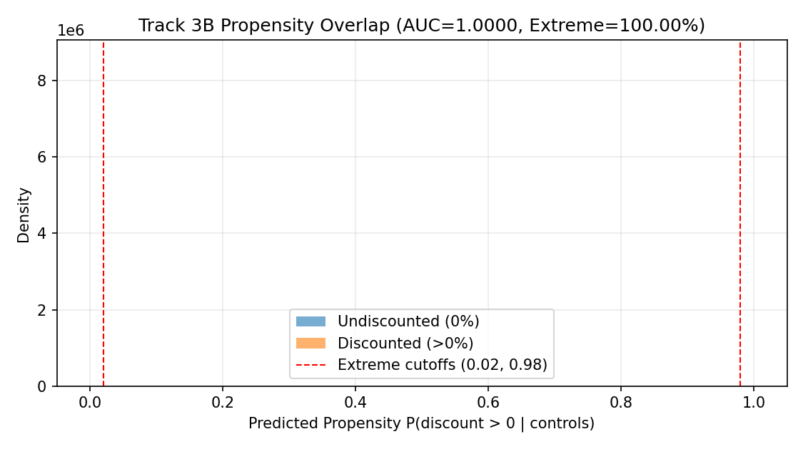
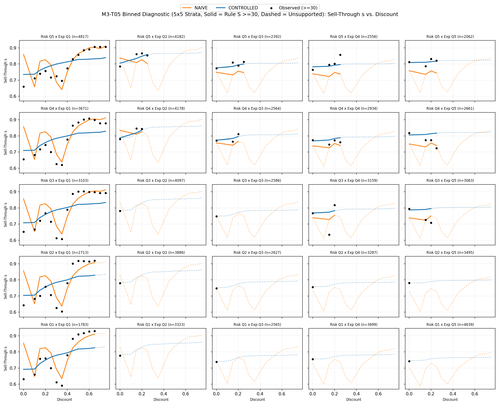
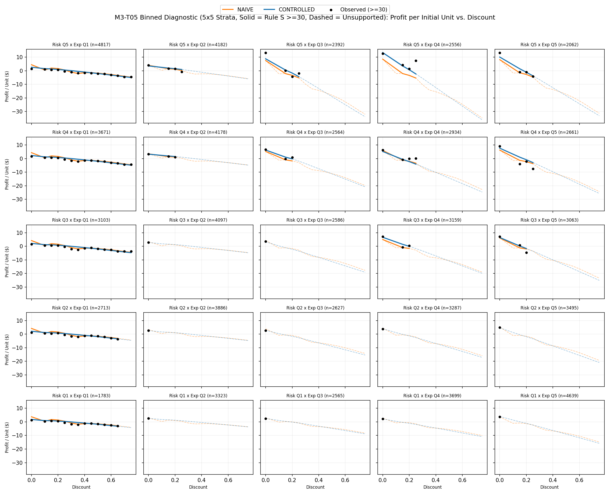
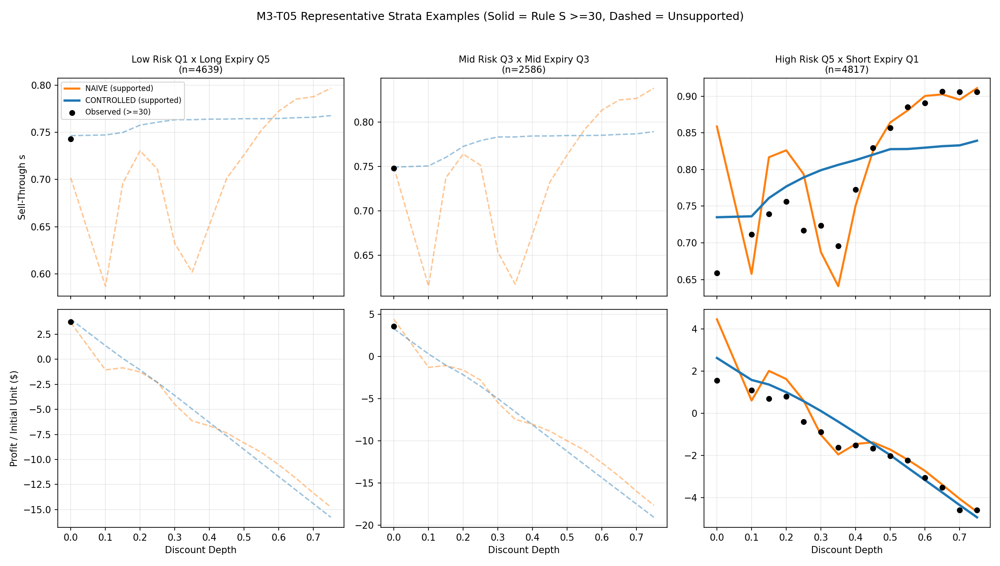

# M3-T05: Track 3B Confounding & Selection-Bias Diagnosis Report

**Task:** M3-T05 — Control-Variable Baseline, Binned Diagnostic & DML Decision  
**Branch:** `M3-T05-confounding-check`  
**MLflow Experiment:** `smart-shelf-3b-revenue-response` (Run ID: `4f3e319110254c3f801e63cbe4203916`)  
**Scope:** Strictly training partition (`split == "train"`, `N = 80,042`). Test partition untouched.

---

## 1. Pre-Registered Rules (Applied Mechanically)

1. **Rule S (Support):** A `(stratum, discount-bin)` cell is *supported* if training data has $\ge 30$ observed rows in that stratum (`oof_proba` quintile $\times$ `expiry_remaining_ratio` quintile, 25 strata) within that 5-point discount bin. Unsupported predictions are shown dashed and never used as evidence.
2. **Rule U (Uniformly Harmful):** The model is *uniformly harmful* if, over supported cells only, predicted profit per initial unit falls monotonically from the lowest to the highest supported discount in $\ge 80\%$ of evaluable strata.
3. **Rule M (Monotone Demand):** Predicted sell-through $s$ is *sensible* if, in supported cells, its average slope vs. discount is $\ge 0$ in $\ge 80\%$ of evaluable strata.
4. **Rule D (DML Escalation):** Recommend DML/EconML only if **(a)** Rule U triggers or Rule M fails, **AND (b)** propensity overlap is adequate ($< 5\%$ of rows with propensity $< 0.02$ or $> 0.98$). Otherwise recommend against.

---

## 2. Counterfactual-Consistency Check

Verified that **zero** features in `TRACK_3B_FEATURES` (excluding `discount_pct`) + `oof_proba` are `selling_price`-based, `markdown` flags, `discount` tiers, or deterministic functions of `discount_pct` (`max |corr| = 0.7891` with `expiry_remaining_ratio`, a pre-sale timing confounder).

---

## 3. Propensity Diagnostics (How Discounts Are Assigned)

- **5-Fold Time-Blocked Propensity Classifier `P(discount_pct > 0 | controls)`:**
  - **OOF ROC-AUC:** **`1.0000`**, **Brier:** **`0.00000`**
  - **Extreme Propensity (`< 0.02` or `> 0.98`):** **`100.00%`** (`69.42%` `< 0.02`, `30.58%` `> 0.98`)
- **Discounted-Only Depth Regressor (`discount_pct | controls`, `n = 24,475`):**
  - **OOF $R^2$:** **`0.8738`**, **OOF RMSE:** **`0.0610`**
- **Depth-3 Decision Tree (`accuracy = 1.0000`):** Discounting is **100% deterministic**:
  - `raw expiry_remaining_ratio <= 0.40` (standardized `<= -0.8373`) $\rightarrow$ `discount > 0`
  - `raw expiry_remaining_ratio > 0.40` AND `quality_grade == 'C'` (`quality_grade_ord <= -1.0585`) $\rightarrow$ `discount > 0`
  - Otherwise $\rightarrow$ `discount == 0`

---

## 4. Fixed Diagnostic Models & Control-Sensitivity Ablations (5-Fold CV)

All models use LightGBM `objective="cross_entropy"` on $s \in [0, 1]$ (`num_leaves=31`, `lr=0.05`, `n_estimators=400`, `min_child_samples=50`, `subsample=colsample=0.8`, `random_state=42`):

| Model / Ablation | OOF RMSE | OOF $R^2$ | Mean $s(0.30) - s(0.00)$ | Shift vs. CONTROLLED |
| :--- | :---: | :---: | :---: | :---: |
| **NAIVE** (`discount_pct` + category) | 0.2617 | 0.1658 | **-0.1189** | -0.1625 |
| **CONTROLLED** (`TRACK_3B_FEATURES` + `oof_proba`) | **0.1219** | **0.8190** | **+0.0436** | 0.0000 |
| `drop_expiry` (`days_until_expiry`, `expiry_remaining_ratio`) | — | 0.8020 | +0.0048 | **-0.0387** |
| `drop_quality` (`quality_grade_ord`) | — | 0.8186 | +0.0528 | **+0.0093** |
| `drop_oof_proba` | — | 0.8198 | +0.0415 | -0.0021 |
| `drop_promoted` (`is_promoted`) | — | 0.8190 | +0.0430 | -0.0005 |
| `drop_store_md` (`store_md_freq_hist`) | — | 0.8190 | +0.0440 | +0.0004 |
| `drop_velocity` (`sales_velocity` & derived) | — | 0.8204 | +0.0436 | +0.0000 |

Controls completely reverse the confounded NAIVE slope (`-0.1189` $\rightarrow$ `+0.0436`). Expiry features are overwhelmingly the dominant confounder (`-0.0387` shift when dropped), followed by `quality_grade_ord` (`+0.0093`).

---

## 5. Binned Diagnostic Plots & Mechanical Verdicts

| Model | Rule U (Harmful Profit) | Rule M (Monotone $s$) | Overlap (`<5%` extreme) | Rule D (Recommend DML?) |
| :--- | :---: | :---: | :---: | :---: |
| **NAIVE** | **False** (`10/15 = 66.7%`) | **False** (`11/15 = 73.3%`) | **False** (`100.0%` extreme) | **False (No)** |
| **CONTROLLED** | **True** (`15/15 = 100.0%`) | **True** (`15/15 = 100.0%`) | **False** (`100.0%` extreme) | **False (No)** |

**Why Rule D = No:** Positivity is completely violated (`100.00%` extreme propensities due to the deterministic assignment rule), so DML/EconML cannot identify treatment effects without positivity.  
**Why Rule U = True despite Rule M = True:** Even though sell-through $s$ rises sensibly (`+4.36` pts from `0%` to `30%`), baseline `0%` sell-through is already high (`0.768`), so a `10%–75%` price cut erodes margin faster than incremental unit recovery on average across all 15 evaluable strata.

---

## 6. Censoring Check (`s == 0` and `s == 1` by Discount Bin)

- **`s == 0`:** `9.46%` at `0%` discount, dropping to `0.00%–0.12%` for discounts $\ge 30\%$.
- **`s == 1`:** `43.14%` at `0%` discount, `9.14%` at `10-15%`, rising monotonically to **`61.42%–65.39%`** at `55%–75%` discounts.
- **Bias note:** Heavy right-censoring at `s = 1` (>60% of deep-discount batches sell out completely) caps observed demand at `initial_quantity`, compressing the measured elasticity at deep markdowns.

---

## 7. Limitations & Deviations from Plan

### Limitations
1. **Non-Random Assignment:** Discounts are not randomly assigned; treatment `discount > 0` is 100% deterministically triggered by `expiry_remaining_ratio <= 0.40` or `quality_grade == 'C'`.
2. **Observational Estimate Only:** All response curves are observational estimates under conditional-ignorability and functional-form assumptions, not proven causal effects; unobserved confounders cannot be ruled out.
3. **Promotional & Store-Frequency Controls Carry No Signal:** `is_promoted` and `store_md_freq_hist` have near-zero correlation with discounting (`-0.0035`, `+0.0023`) in this synthetic dataset, so separating promotional markdowns from spoilage-driven markdowns could not be achieved.
4. **Synthetic Data:** All dynamics reflect synthetic data generation rules rather than live retail elasticity.

### Deviations from Plan
- **Support cell check in `discount_support()`:** `10` of `25` `(oof_q, exp_q)` strata have `< 2` supported discount bins (`15` evaluable strata), so `discount_support()` flags both per-grid-point support (`>= 30` rows) and `no_undiscounted_history` per stratum for Track 3C.
