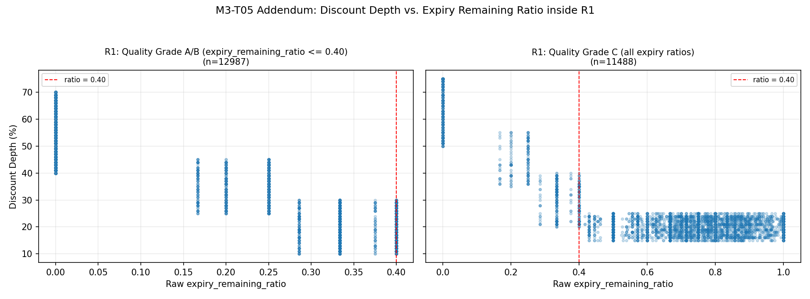
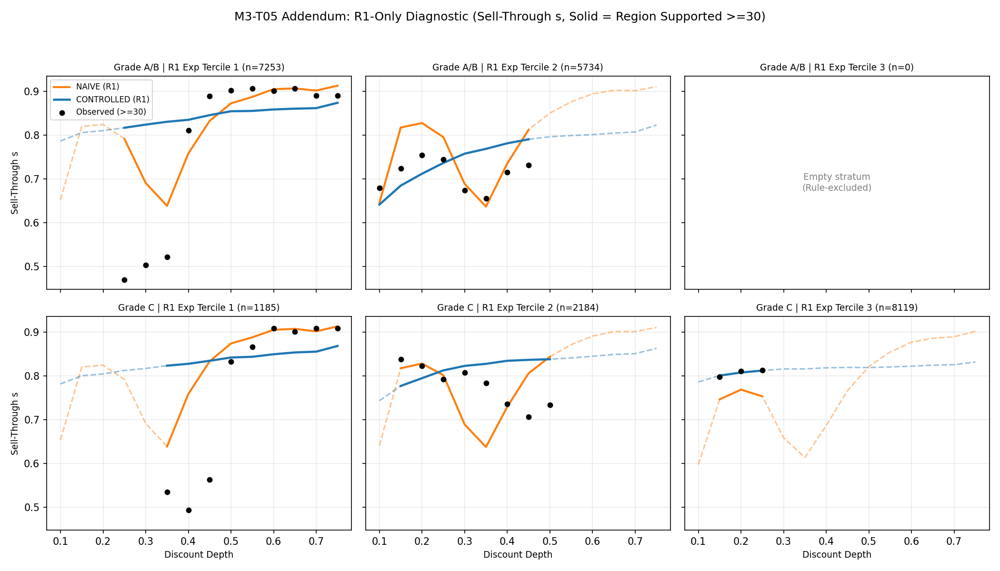
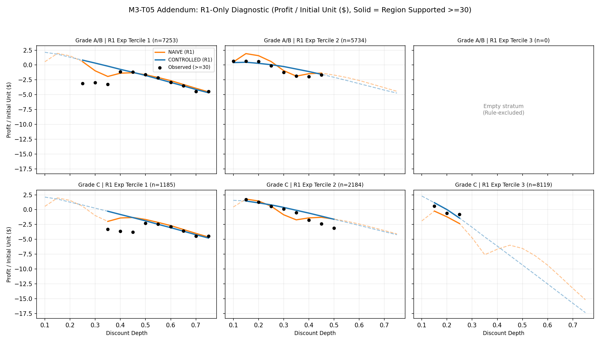

# M3-T05: Track 3B Confounding & Selection-Bias Diagnosis Report

**Task:** M3-T05 — Control-Variable Baseline, Binned Diagnostic, DML Decision & R1 Addendum  
**Branch:** `M3-T05-confounding-check`  
**MLflow Experiment:** `smart-shelf-3b-revenue-response` (Pass 1 Run: `4f3e319110254c3f801e63cbe4203916`; Addendum Run: `7b9dd2dcd299464d90f90dafcf80b9a4`)  
**Scope:** Strictly training partition (`split == "train"`, `N = 80,042`). Test partition untouched.

---

## Headline: Discount Assignment Is Rule-Based

In the training partition (`N = 80,042`), whether a batch receives a discount (`discount_pct > 0`) is **100.00% deterministically governed by a two-clause rule with zero violations**:
$$\text{discount\_pct} > 0 \iff (\text{raw\_expiry\_remaining\_ratio} \le 0.40) \;\lor\; (\text{quality\_grade} == \text{'C'})$$

| Rule Variant | Violations (out of 80,042) | Details |
| :--- | :---: | :--- |
| `raw_expiry_remaining_ratio <= 0.40 OR quality_grade == 'C'` | **0** | Exact boundary (`1,588` non-C rows at exact `0.40` are all discounted) |
| `raw_expiry_remaining_ratio < 0.40 OR quality_grade == 'C'` | 1,588 | Boundary `0.40` is inclusive (`<=`) |

- **Group shares:** `quality_grade == 'C'` = `14.35%` (`11,488` rows); `ratio <= 0.40` = `18.89%` (`15,122` rows); overlap (both) = `2.67%` (`2,135` rows).
- **Regions:**
  - **R0 (Rule says no discount, `ratio > 0.40` & `grade != 'C'`):** `55,567` rows (`69.42%`), `s` mean `0.7679` (`std 0.309`, median `0.892`, `s=0`: `9.46%`, `s=1`: `43.14%`), profit/unit **`+$4.57`**, loss share `16.8%`. **Zero discounted batches exist in R0.**
  - **R1 (Rule says discount, `ratio <= 0.40` OR `grade == 'C'`):** `24,475` rows (`30.58%`), `s` mean `0.7986` (`std 0.240`, median `0.867`, `s=0`: `2.21%`, `s=1`: `41.58%`), profit/unit **`-$0.78`**, loss share `54.0%`. **Zero undiscounted batches exist in R1.**

### Revision of First-Pass Verdicts
Because R0 and R1 are completely disjoint (`0%` propensity overlap), **the first-pass Rule U (`15/15`) and Rule M (`15/15`) verdicts rested on extrapolation across the R0/R1 boundary, and the `+0.0436` sell-through gain from `0%` to `30%` discount is a model extrapolation, not a measured effect.** Within R0, no discount response is observable; within R1, `0%` is never observed, so only **depth variation among positive discounts (`10%–75%`)** is empirically identifiable.

---

## 1. Pre-Registered Rules (Applied Mechanically)

1. **Rule S (Superseded Coarse Support) & Region-Based Support (`discount_support`):** Coarse 5×5 quintile support (`discount_support_coarse`) crossed the R0/R1 boundary and is superseded. Under region-based support:
   - **R0 rows:** `0%` is `"ok"` (`supported=True`); any `d > 0` is `supported=False` (`reason="no_discount_region"`).
   - **R1 rows:** `0%` is `supported=False` (`reason="no_zero_history"`); `d > 0` is `"ok"` (`supported=True`) iff training R1 has $\ge 30$ rows in that 5-point depth bin within the same `(quality_grade == 'C', R1 expiry_remaining_ratio tercile)` cell (else `"thin_depth_bin"`).
2. **Rule U / Rule M / Rule D (Pass 1):** Rule U (profit/unit falls monotonically across supported discounts in $\ge 80\%$ of strata); Rule M ($s$ slope $\ge 0$ in $\ge 80\%$); Rule D (DML only if Rule U/M fails AND extreme propensity $< 5\%$).
3. **Rule E (Addendum — Usable Quasi-Random Depth Variation in R1):** Residual depth inside R1 is usable as quasi-random variation **only if**: **(i)** OOF residual SD $\ge 3.0$ discount points, **AND (ii)** OOF $R^2$ of the residual predicted from store, supplier, product, month, day-of-week, handling, packaging, temp abuse, daily demand, and `oof_proba` is $< 0.05$.

---

## 2. Depth Assignment & Quasi-Random Variation Inside R1 (`N = 24,475`)

- **Distinct depths:** `61` distinct values in Grade C and `61` in Grade A/B (tiered/noisy function of expiry and quality, not a single deterministic step).
- **`depth ~ controls` (5-fold time-blocked LightGBM):** OOF $R^2 = \mathbf{0.8738}$, **residual SD = `6.10` discount points** ($\ge 3.0$ pts $\checkmark$).
- **`residual ~ other features` (store, supplier, product, month, dow, handling, packaging, temp_abuse, daily_demand, `oof_proba`):** **OOF $R^2 = \mathbf{-0.0704}$** ($< 0.05$ $\checkmark$).
- **Rule E Verdict: PASSED (`SD = 6.10 >= 3.0` and `resid R^2 = -0.0704 < 0.05`).** Residual depth inside R1 is usable quasi-random variation!

---

## 3. Local Depth Effect Inside R1 Only (Diagnostic)

- **R1-Only Fixed LightGBM (`cross_entropy`):** NAIVE OOF $R^2 = 0.1645$ (`RMSE = 0.2199`) vs. CONTROLLED OOF $R^2 = \mathbf{0.7038}$ (`RMSE = 0.1309`).
- **Cross-Fitted Partialling-Out Slope ($\Delta s / \Delta d$ within R1):**
  - **Slope:** **`+0.2614`** (**`+2.61` sell-through percentage points per `+10%` discount**), **95% week-grouped bootstrap CI (`500` resamples): `[+0.2342, +0.2880]`**.
  - **Control sensitivity:** Dropping `expiry` shifts slope by `+0.0411` (`+0.3025`); all other control groups (`velocity`, `oof_proba`, `promoted`, `store_md`, `quality`) shift by $< 0.008$.
  - **Depth-band heterogeneity (diminishing returns / censoring saturation):**
    - `10-30%` (`n=14,524`): slope **`+0.5051`** (`+5.05` pts per `+10%` discount)
    - `30-50%` (`n=4,594`): slope **`+0.2616`** (`+2.62` pts per `+10%` discount)
    - `50-75%` (`n=5,357`): slope **`+0.0739`** (`+0.74` pts per `+10%` discount)

---

## 4. First-Pass Diagnostics (Full Training Set, Preserved for Record)

- **Counterfactual-consistency check:** 0 treatment-derived features in `TRACK_3B_FEATURES` + `oof_proba` (`max |corr| = 0.7891`).
- **Propensity classifier:** AUC `1.0000`, Brier `0.00000`, `100.00%` extreme propensities (`<0.02` or `>0.98`). **Rule D = False (Recommend AGAINST DML/EconML)** due to total positivity violation across R0/R1.
- **Pass-1 Full-Train Models:** NAIVE $R^2 = 0.1658$ (`s(0.30)-s(0) = -0.1189`) vs. CONTROLLED $R^2 = 0.8190$ (`s(0.30)-s(0) = +0.0436`, extrapolated across R0/R1).
- **Censoring:** `s == 1` rises from `9.14%` (`10-15%`) to `61.4%–65.4%` (`55%–75%`), compressing measured elasticity at deep discounts.

---

## 5. Implications for T06, T07, T08 & Track 3C

- **What CAN be claimed:** Within **R1** and supported depth bins, deeper discounts causally/quasi-experimentally raise sell-through (`+2.61` pts per `+10%` discount overall, `+5.05` pts in `10–30%`, diminishing to `+0.74` pts in `50–75%`).
- **What CANNOT be claimed:** Any `0%` vs `> 0%` treatment effect in R0 (never discounted) or R1 (never undiscounted) is an unverified model extrapolation.
- **T06 (Final Track 3B Regressor):** Train on `R1` (or full data with explicit `discount_support()` gating), knowing depth elasticity is identified **only inside R1**.
- **T07 (Shape Check):** Verify profit-vs-discount and sell-through monotonicity **inside R1 supported depths only** (`10%–75%`).
- **T08 (Elasticity View):** Report per-category elasticity curves **within R1** only.
- **Track 3C (Optimizer & Backtest):** For **R0** batches, recommend `0%` (no evidence-based discount); optimize depth only for **R1** batches over supported `R1` depths. **Lane 1** matched historical evaluation applies only to rule-discounted **R1** batches.

---

## 6. Limitations & Deviations from Plan

### Limitations
1. **Rule-Based Assignment:** `discount > 0` is 100% deterministic (`expiry_remaining_ratio <= 0.40` or `grade == 'C'`). No `0%` vs `>0%` overlap exists anywhere.
2. **Observational / Quasi-Experimental Estimate:** Even inside R1, depth identification relies on conditional ignorability given controls; unobserved confounders cannot be ruled out.
3. **Promotional & Store-Frequency Controls Carry No Signal:** `is_promoted` and `store_md_freq_hist` have near-zero correlation with discounting (`-0.0035`, `+0.0023`).
4. **Censoring at `s = 1` & Synthetic Data:** Heavy saturation (`>60%` at `s=1` for deep discounts) and synthetic generation limit external validity.

### Deviations from Plan
- **Region-Based Support Replaces Coarse 5×5 Rule S:** `discount_support()` in `src/m3_t05_confounding.py` enforces `R0`/`R1` separation and `(grade_C × R1_expiry_tercile × depth_bin)` $\ge 30$ support; old `discount_support_coarse()` is retained only for reference.
