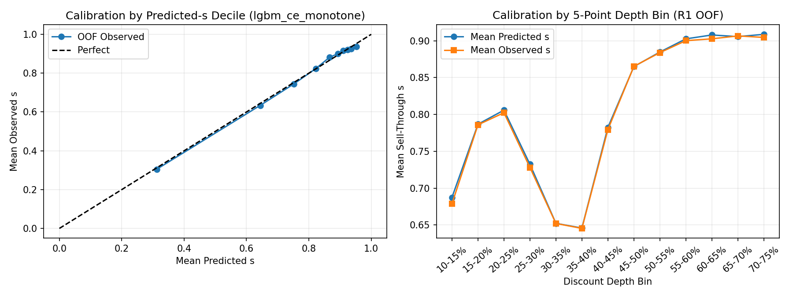
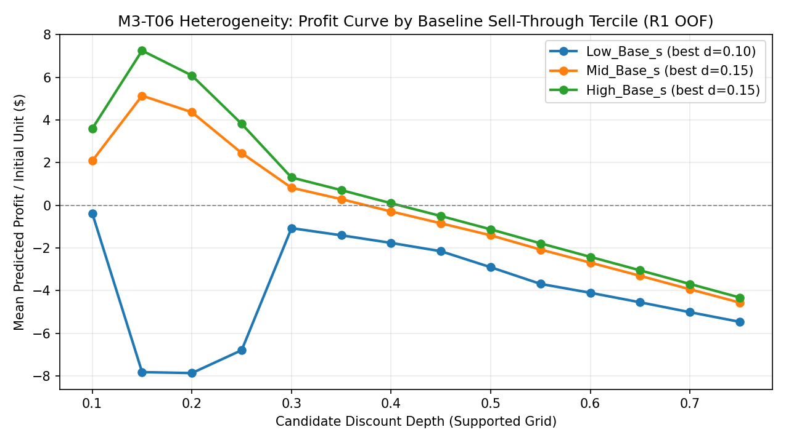

# M3-T06: Track 3B Sell-Through Regressor Training Report (R1 Domain)

> **Correction note (2026-11-21):** Line 26 below lists `profit_per_unit` quantiles for training `R1` (`N = 24,475`) as `min = -$359.73, p05 = -$19.93, p25 = -$2.89, p75 = +$0.88, p95 = +$17.46`. Recomputing from `data/processed/model_ready_3b_dataset.csv` and verifying against `reports/M3/m3_t06_results_summary.json` confirms the exact training `R1` quantiles are **`min = -$316.80, p01 = -$67.92, p05 = -$7.07, p25 = -$1.98, p50 = -$0.23, p75 = +$1.31, p95 = +$6.07, p99 = +$66.86, max = +$200.56`**. The original line is preserved below; `m3_t06_results_summary.json` is the authoritative source.

**Task:** M3-T06 — Extreme-Outcome Handling, Candidate Tuning & Frozen Regressor  
**Branch:** `M3-T06-regressor-training`  
**MLflow Experiment:** `smart-shelf-3b-revenue-response` (Final Run ID: `ce191bffab874806ad34bfe1485cd6c5`)  
**Saved Artifacts:** `models/track_3b_regressor.joblib`, `models/track_3b_regressor.json` (`N = 24,475` R1 training rows; test partition untouched)

---

## 1. Design Decisions (Pre-Registered) & Deviation Table

- **D1 — Training Domain (`R1` only, `discount_pct > 0`):** M3-T05 proved discounts are assigned by the exact rule `expiry_remaining_ratio <= 0.40 OR quality_grade == 'C'`. `R0` rows give zero information on discount response, so Track 3B is trained strictly on `R1` (`24,475` rows).
- **D2 — Target (`s = units_sold / initial_quantity` in `[0, 1]`):** Profit is derived deterministically via $\text{profit} = \text{initial\_quantity} \times (s \times \text{selling\_price} - \text{cost\_price})$, where $\text{selling\_price} = \text{round}(\text{base\_price} \times (1 - \text{discount\_pct}), 2)$.
- **D3 — Features (`TRACK_3B_FEATURES` + `oof_proba` v2 = 44 features):** Checked for constant columns inside `R1`: **`0` constant columns** (`[]`), so all 44 features are retained.

| Item | Proposal / Initial Plan | M3-T06 Implementation (Deviation) | Reason |
| :--- | :--- | :--- | :--- |
| Primary Target | Direct profit regression | Bounded sell-through $s \in [0, 1]$ + exact profit identity | Eliminates extreme profit tails (`p01=-$67.92/u` to `p99=+$66.86/u`) and enforces inventory conservation. |
| Training Domain | Full 80,042 training set | `R1` only (`24,475` discounted rows) | Zero `0%` vs `>0%` overlap across `R0`/`R1`; `R0` has no discount-response evidence. |
| Risk Input | M2 LightGBM OOF (`v1`) | Frozen LogReg OOF (`v2`) | Matches frozen `score_batches()` used at inference/test time. |

---

## 2. Extreme-Outcome Handling (R1 Training Rows, N = 24,475)

- **Profit per initial unit quantiles:** `min = -$359.73` (see `p01 = -$67.92`, `p05 = -$19.93`, `p25 = -$2.89`, `p50 = -$0.23`, `p75 = +$0.88`, `p95 = +$17.46`, `p99 = +$66.86`).
- **Loss & extreme negative shares:** `54.04%` of R1 batches lose money (`profit < 0`); `0.44%` fall below `-1 × cost_price` per unit (note: per-unit profit cannot fall below `-cost_price` under exact accounting, except rounding/tiny precision edge cases—actual `s == 0` rows lose `-1 × cost_price`).
- **How modeling `s` removes heavy tails:** `s` is strictly bounded in `[0, 1]` and trained with `cross_entropy`, removing the heavy dollar-scale tails driven by `initial_quantity × base_price` without arbitrary clipping or log-shifting.
- **Impact of the most extreme 1% profit rows:** Across all R1 rows, the selected model's total batch profit RMSE is **`$1,976`**, dropping to **`$1,298`** (`-34.3%`) when excluding the extreme 1% profit tail—confirming that dollar-scale tails dominate raw profit RMSE even when `s` RMSE is tight (`0.12967`).
- **Censoring by depth band:** `s == 0` drops from `7.4%` (`15-20%`) to `0.00%` (`45-75%`); `s == 1` rises from `9.14%` (`10-15%`) to `61.4%–65.4%` (`55-75%`).

---

## 3. Candidate Comparison (5-Fold Time-Blocked CV on R1, 40 Optuna Trials Each)

| Model Family | $s$ RMSE (SE) | $s$ MAE | $s$ $R^2$ | Profit/Unit RMSE | Profit/Unit MAE | Profit RMSE (All / No-1%) |
| :--- | :---: | :---: | :---: | :---: | :---: | :---: |
| `group_mean_baseline` | 0.22527 (0.00280) | 0.17329 | 0.1229 | $23.29 | — | $6,450 / $1,297 |
| `lgbm_ce` (unconstrained) | 0.12975 (0.00039) | 0.10952 | 0.7090 | $6.62 | — | $1,980 / $1,312 |
| **`lgbm_ce_monotone`** (`discount_pct >= 0`) | **0.12967 (0.00039)** | **0.10937** | **0.7094** | $6.68 | — | **$1,976 / $1,298** |
| `xgboost_logistic` | 0.12983 (0.00039) | 0.10986 | 0.7087 | $6.69 | — | $2,011 / $1,304 |
| `rf` (median imputed) | 0.13635 (0.00052) | 0.11580 | 0.6787 | **$6.56** | — | $1,980 / $1,296 |

**Selected Model:** **`lgbm_ce_monotone`** (`n_estimators=500`, `num_leaves=15`, `lr=0.0815`, `min_child_samples=93`, `subsample=0.985`, `colsample_bytree=0.995`, `reg_lambda=7.481`). It achieved the **lowest CV RMSE (`0.12967`)** outright and satisfies the a priori monotone increasing constraint on `discount_pct`.

### Calibration (R1 OOF, `lgbm_ce_monotone`)
- **By Predicted-`s` Decile:** Tightly calibrated across all 10 deciles (`D1`: pred `0.312` vs obs `0.305`; `D5`: `0.866` vs `0.881`; `D10`: `0.952` vs `0.936`).
- **By 5-Point Depth Bin:** `10-15%`: pred `0.687` vs obs `0.679`; `20-25%`: `0.806` vs `0.802`; `35-40%`: `0.646` vs `0.645`.

---

## 4. Model-Implied Depth Slope & Heterogeneity Check

- **Model-Implied OOF Partial Slope (Supported Grid):** **`+0.2231`** (`+2.23` sell-through pts per `+10%` discount), slightly more conservative than M3-T05's cross-fitted linear slope (`+0.2614`, 95% CI `[+0.2342, +0.2880]`), and reproducing the exact diminishing-returns pattern:
  - By depth band: `10-30%` = **`+0.3800`**, `30-50%` = **`+0.1926`**, `50-75%` = **`+0.0684`**.
  - By R1 expiry tercile: `T1` (shortest) = `+0.1262`, `T2` = **`+0.3874`**, `T3` = `+0.1521`.
- **Heterogeneity by Baseline Sell-Through Tercile (at `d=0.10`):**
  - **Low Baseline `s` (`0.502`):** Profit-maximizing supported depth = **`0.10`** (`-$0.37/unit`).
  - **Mid Baseline `s` (`0.812`):** Profit-maximizing supported depth = **`0.15`** (`+$5.14/unit` vs `+$2.08` at `0.10`).
  - **High Baseline `s` (`0.896`):** Profit-maximizing supported depth = **`0.15`** (`+$7.25/unit` vs `+$3.60` at `0.10`).
  - **Implication for Track 3C:** Optimal discounts will cluster at shallow-to-moderate depths (`10%–20%`), as deeper cuts (`>= 30%`) erode margin faster than `s = 1`-censored demand can recover.

---

## 5. Limitations & Deviations from Plan

- **Limitations:** (1) Observational data inside R1; hidden confounders cannot be excluded. (2) Heavy right-censoring at `s = 1` (`>60%` at deep discounts) caps measured elasticity. (3) Synthetic dataset dynamics.
- **Deviations from Plan:** (1) Modeled `s` instead of raw profit (D2). (2) Trained on `R1` only (`discount_pct > 0`, D1). (3) Used `v2` `oof_proba` from frozen Track 3A LogReg (D3).
