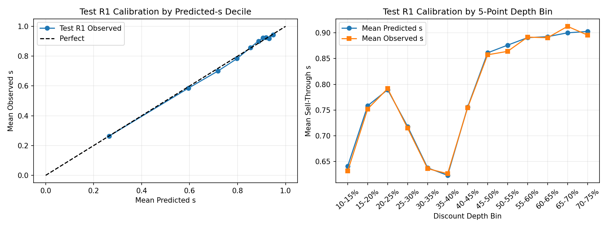
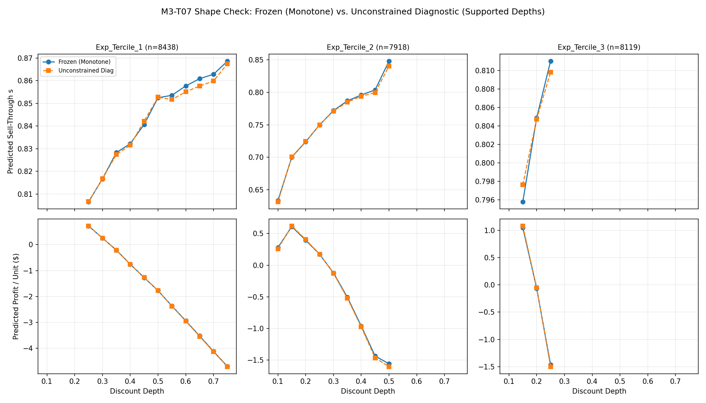

# M3-T07: Track 3B Final Test Evaluation & Discount-Curve Shape Report

**Task:** M3-T07 — Single Final Test Evaluation & Shape Sanity Check  
**Branch:** `M3-T07-regressor-evaluation`  
**MLflow Experiment:** `smart-shelf-3b-revenue-response`  
- Final Test Evaluation Run: `d3ed3411ecd3464b8baf57aefd62557d` (`purpose=final_test_evaluation`)  
- Unconstrained Shape Diagnostic Run: `72c8f7481d7542be83ac42261935461a` (`purpose=shape_diagnostic`)  
**Frozen Model:** `models/track_3b_regressor.joblib` (`lgbm_ce_monotone`, evaluated ONCE on test `R1`)

---

## 1. Pre-Registered Pass/Fail Rules (Written Before Viewing Results)

1. **Rule T1 (Generalization):** Test `R1` RMSE on $s$ must be $\le 1.15 \times \text{CV RMSE}$ ($\le 0.14912$) **AND** test `R1` $R^2$ on $s$ must be $\ge \text{CV } R^2 - 0.05$ ($\ge 0.6594$).
2. **Rule T2 (Shape Sanity — Unconstrained Diagnostic):** Because the frozen model enforces a monotone constraint on `discount_pct`, an unconstrained `lgbm_ce` (identical hyperparameters, fit on training `R1` only) is used to test whether the data itself supports a non-decreasing $s$-vs-depth curve. Rule T2 passes if the unconstrained model's average partial slope $\Delta \hat{s}/\Delta d$ is positive in $\ge 80\%$ of `(expiry tercile × baseline tercile × depth band 10-30 / 30-50 / 50-75)` cells with $\ge 200$ training rows, **AND** no cell has a significantly negative slope (bootstrap 95% CI entirely $< 0$).

---

## 2. Test-Set Integrity Checks (N = 19,958)

- **Region Rule Violations:** **`0` violations** out of `19,958` test rows (`discount_pct > 0` iff `expiry_remaining_ratio <= 0.40 OR quality_grade == 'C'`).
- **Region Sizes:** `R0` = `13,782` (`69.06%`); `R1` = `6,176` (`30.94%`).
- **Supported Training Depth Share in Test `R1`:** **`100.00%`** of test `R1` batches fall in a supported training 5-point depth bin (`10-15%`: 254, `15-20%`: 1,321, `20-25%`: 1,438, `25-30%`: 536, `30-35%`: 260, `35-40%`: 222, `40-45%`: 450, `45-50%`: 284, `50-55%`: 339, `55-60%`: 325, `60-65%`: 286, `65-70%`: 337, `70-75%`: 124).
- **Distribution Shift (`Train R1` vs. `Test R1`):**
  - `oof_proba`: train mean `0.2281` (`sd 0.0510`) vs. test mean `0.2264` (`sd 0.0510`)
  - `raw_expiry_remaining_ratio`: train mean `0.3859` (`sd 0.3269`) vs. test mean `0.3795` (`sd 0.3303`)
  - `s`: train mean `0.7986` (`sd 0.2405`) vs. test mean `0.7802` (`sd 0.2516`)

---

## 3. Primary Evaluation on Test `R1` (N = 6,176) & Rule T1 Verdict

| Evaluator | $s$ RMSE | $s$ MAE | $s$ $R^2$ | Profit/Unit RMSE | Profit/Unit MAE | Batch Profit RMSE (All / No-1%) |
| :--- | :---: | :---: | :---: | :---: | :---: | :---: |
| **Frozen `lgbm_ce_monotone` (Test R1)** | **0.12781** | **0.10810** | **0.7419** | **$6.37** | **$1.73** | **$1,793 / $1,204** |
| Frozen CV Reference (`lgbm_ce_monotone`) | 0.12967 | 0.10937 | 0.7094 | $6.68 | — | $1,976 / $1,298 |
| `GroupMeanBaseline` (Test R1) | 0.23502 | 0.17927 | 0.1274 | $24.09 | — | — |

**Rule T1 Verdict: PASSED** (`0.12781 <= 0.14912` and `0.7419 >= 0.6594`). Test generalization slightly improves on CV.

### Subgroup Errors & Calibration (`Test R1`)
- **By R1 Expiry Tercile:** `T1` (`n=2,211`): `s_RMSE=0.1257`, `R2=0.6371`; `T2` (`n=1,965`): `s_RMSE=0.1304`, `R2=0.5383`; `T3` (`n=2,000`): `s_RMSE=0.1276`, `R2=0.8428`.
- **By Grade Group:** `Grade A/B` (`n=3,366`): `s_RMSE=0.1262`, `R2=0.6479`, `p_u_RMSE=$1.28`; `Grade C` (`n=2,810`): `s_RMSE=0.1297`, `R2=0.8012`, `p_u_RMSE=$9.34`.
- **Calibration:** Tightly aligned across predicted-$s$ deciles and all 13 depth bins (e.g., `15-20%`: pred `0.758` vs obs `0.752`; `20-25%`: `0.790` vs `0.792`; `45-50%`: `0.861` vs `0.857`; `65-70%`: `0.900` vs `0.913`).

### Test `R0` Descriptive Summary (Outside Model Domain, N = 13,782)
- `s` mean = `0.7525`, mean profit/unit = `+$3.54`, loss share = `18.9%`.
- Confirmed `predict_profit_curve()` flags all `R0` rows with `supported=False`, `NaN` predictions, and `reason="region_R0_no_discount_evidence"`.

---

## 4. Shape Sanity Check & Rule T2 Verdict

- **Rule T2 (Unconstrained Diagnostic on Train R1):** Across `15` `(expiry tercile × baseline tercile × depth band)` cells with $\ge 200$ training rows, **`100.0%` (`15/15`)** have a positive unconstrained partial slope and **`0` cells** have a significantly negative 95% CI. **Rule T2 Verdict: PASSED.**
- **Test-Period Empirical Residual Slope (Models Fit on Train R1 Only):** **`+0.2911`** (`95%` week-grouped bootstrap CI **`[+0.2369, +0.3522]`** across 22 test weeks), consistent with M3-T05's training estimate (`+0.2614`, CI `[+0.2342, +0.2880]`) and M3-T06's model-implied slope (`+0.2231`).
- **Profit-vs-Depth Shape (`10%–75%` Supported Depths):**
  - `Exp_Tercile_1`, `Exp_Tercile_3`, `Base_s_Tercile_1`: **highest at shallowest supported depth** (`0.10` / `0.25` for `T1` where `0.10–0.20` are thin).
  - `Exp_Tercile_2`, `Base_s_Tercile_2`, `Base_s_Tercile_3`: **interior maximum** (rises from `0.10` to `0.15`, then falls monotonically).
- **Censoring at `s = 1` on Test `R1`:** `s == 1` rises from `5.9%` (`10-15%`) and `5.4%` (`35-40%`) to **`54.3%–68.0%`** at `50%–75%`, compressing measured slope at deep discounts.

---

## 5. Verdict: Readiness for Track 3C

**Track 3B (`models/track_3b_regressor.joblib`) is READY to drive Track 3C optimization strictly inside `R1` supported depths (`10%–75%`).**
- **Claims it CAN support:** Within `R1`, predicted sell-through $s$ is well-calibrated (`R2 = 0.7419`, `RMSE = 0.12781`), generalizes cleanly to unseen future dates (Rule T1), and exhibits a genuine positive demand response confirmed without monotonicity constraints (Rule T2 & test residual slope `+0.2911`).
- **Claims it CANNOT support:** Any `0%` vs `> 0%` treatment effect, any discount recommendation on `R0` batches, or extrapolation outside `[0.10, 0.75]`.
- **Dashboard & Track 3C Flags Required:** (1) `R0` batches: display *"No historical discount evidence for this region (`0%` recommended)"*; (2) `R1` batches: score only `[0.10, 0.75]` and flag `"thin_depth_bin"` where training support $< 30$ rows (especially deep cuts `>= 60%`).

---

## 6. Limitations & Deviations from Plan

- **Limitations:** Observational depth variation inside `R1` (hidden confounders cannot be excluded); heavy right-censoring at `s = 1` (`>54%` at `>= 50%` discounts); synthetic data generation.
- **Deviations from Plan:** The proposal/Notion card's `"rises then falls"` profit check against `0%` discount cannot be tested on `R1` because `R1` contains zero undiscounted batches; instead, shape is evaluated across `[0.10, 0.75]` supported depths.
