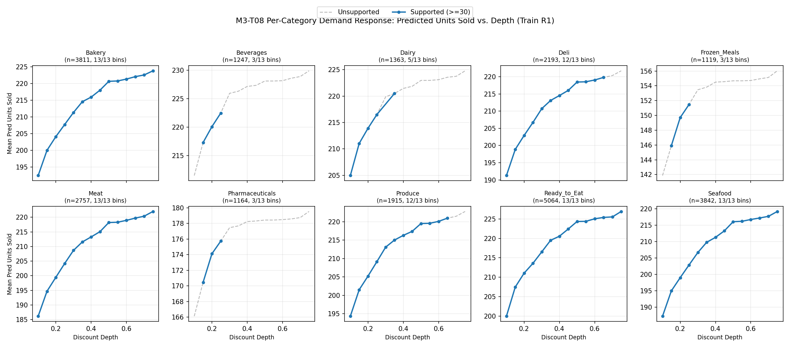
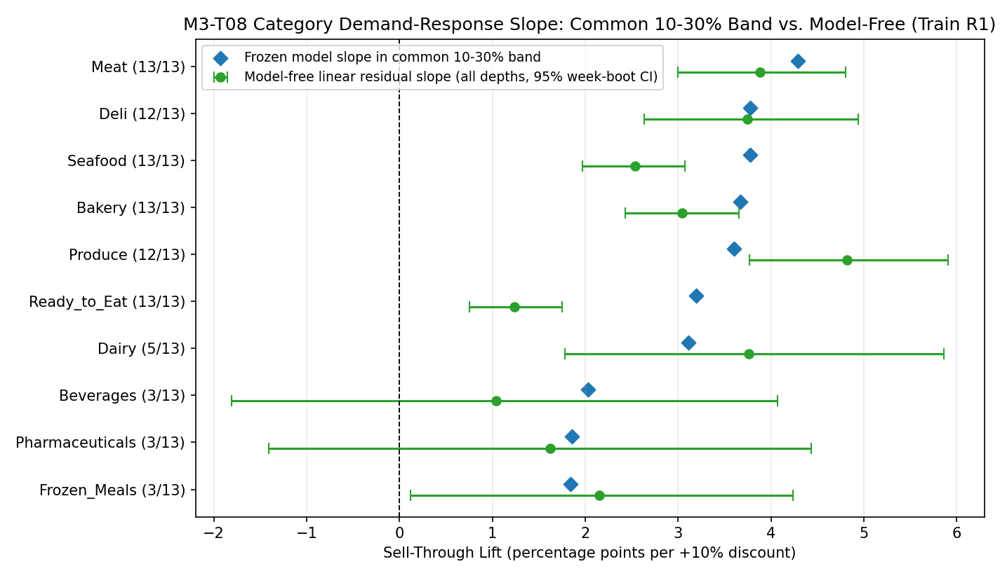

# M3-T08: Track 3B Per-Category Demand-Response (Elasticity) View Report

**Task:** M3-T08 — Category Elasticity View from Frozen Track 3B Regressor  
**Branch:** `M3-T08-elasticity-view`  
**MLflow Experiment:** `smart-shelf-3b-revenue-response` (Run ID: `c770f14daf394111bbe467a0101d929a`)  
**Source Model:** Frozen `models/track_3b_regressor.joblib` (`lgbm_ce_monotone`, evaluated on Training `R1` rows only, `N = 24,475`; no refitting, no test-set use)  
**Dashboard CSV:** `reports/tables/M3_T08_category_elasticity.csv` (140 rows = 10 categories × 14 depths)

---

## 1. Pre-Registered Rules (Written Before Viewing Results)

1. **Rule C1 (Category Support):** A category is *"low confidence"* if it has `< 300` training `R1` rows **OR** `< 3` of the 5-point depth bands (`10-75%`) with $\ge 30$ training `R1` rows.
2. **Rule C2 (Depth-Band Support):** A `(category, depth band)` cell is plotted solid and included in summary numbers only if it has $\ge 30$ training `R1` rows; otherwise it is dashed/greyed and excluded.
3. **Rule C3 (`spoilage_sensitivity` Cross-Check):** Descriptive ranking sanity check only (not independent validation, since `spoilage_sensitivity` is exact-collinear with category, $R^2 = 1.0$).

---

## 2. Category Support & Structural Coverage Gaps (Train `R1`, N = 24,475)

| Category | Train `R1` Rows | Supported Bins (`>=30`) | Rule C1 Pass? | `limited_depth_range` (`<8/13`) | Grade Breakdown (`A / B / C`) |
| :--- | :---: | :---: | :---: | :---: | :--- |
| `Ready_to_Eat` | 5,064 | 13 / 13 | Yes | `False` | `1,687 / 2,216 / 1,161` |
| `Seafood` | 3,842 | 13 / 13 | Yes | `False` | `1,106 / 1,579 / 1,157` |
| `Bakery` | 3,811 | 13 / 13 | Yes | `False` | `1,098 / 1,573 / 1,140` |
| `Meat` | 2,757 | 13 / 13 | Yes | `False` | `702 / 955 / 1,100` |
| `Deli` | 2,193 | 12 / 13 | Yes | `False` | `441 / 586 / 1,166` |
| `Produce` | 1,915 | 12 / 13 | Yes | `False` | `309 / 411 / 1,195` |
| `Dairy` | 1,363 | 5 / 13 | Yes | **`True`** | `91 / 130 / 1,142` |
| `Beverages` | 1,247 | 3 / 13 | Yes | **`True`** | `34 / 69 / 1,144` |
| `Pharmaceuticals` | 1,164 | 3 / 13 | Yes | **`True`** | `0 / 0 / 1,164` (100% Grade C) |
| `Frozen_Meals` | 1,119 | 3 / 13 | Yes | **`True`** | `0 / 0 / 1,119` (100% Grade C) |

- **Rule C1 & Post-Hoc Depth-Range Observation:** Pre-registered Rule C1 passed all 10 categories (`>= 300` rows and `>= 3` bins `>= 30`), but was **too lenient about depth coverage**—an observation made after seeing the results (Rule C1 itself is not rewritten). Four categories (`Dairy`, `Beverages`, `Pharmaceuticals`, `Frozen_Meals`) have fewer than 8 of 13 depth bands supported and are flagged `limited_depth_range = True` in `category_elasticity_table()`.
- **Structural Support Gap:** `Frozen_Meals` and `Pharmaceuticals` enter `R1` **exclusively via `quality_grade == 'C'`** (`100%` `exp > 0.40`, `0` Grade A/B rows), and `Beverages` (`91.7%` Grade C) / `Dairy` (`83.8%` Grade C) are similarly restricted to shallow `10-25%` markdowns.

---

## 3. Per-Category Demand Response & Model vs. Model-Free Comparison

*Note: Cross-category comparisons below are made within the **common `10-30%` depth band** only, because overall model slopes depend on each category's supported depth range (categories with `12–13/13` bins include the flat `50-75%` tail, whereas `limited_depth_range` categories only cover `10-25%` or `10-35%`).*

| Category | Model `10-30%` (Common Band) | Model `30-50%` | Model `50-75%` | Model Overall (Range-Dependent) | Model-Free Linear Slope (All Depths, 95% CI) | Overall in CI? |
| :--- | :---: | :---: | :---: | :---: | :---: | :---: |
| `Meat` (`13/13`) | **+4.29** | +1.91 | +0.57 | +2.13 | +3.88 `[+2.99, +4.80]` | No |
| `Deli` (`12/13`) | **+3.78** | +1.58 | +0.32 | +2.04 | +3.74 `[+2.63, +4.94]` | No |
| `Seafood` (`13/13`) | **+3.78** | +1.91 | +0.48 | +1.94 | +2.53 `[+1.97, +3.08]` | No |
| `Bakery` (`13/13`) | **+3.67** | +1.89 | +0.49 | +1.90 | +3.05 `[+2.43, +3.65]` | No |
| `Produce` (`12/13`) | **+3.60** | +1.28 | +0.34 | +1.87 | +4.82 `[+3.77, +5.91]` | No |
| `Ready_to_Eat` (`13/13`) | **+3.20** | +1.60 | +0.40 | +1.63 | +1.24 `[+0.76, +1.75]` | Yes |
| `Dairy` (`5/13`, limited) | **+3.11** | — | — | +3.11 | +3.76 `[+1.78, +5.86]` | Yes |
| `Beverages` (`3/13`, limited) | **+2.03** | — | — | +2.03 | +1.04 `[-1.81, +4.07]` | Yes |
| `Pharmaceuticals` (`3/13`, limited) | **+1.86** | — | — | +1.86 | +1.62 `[-1.41, +4.43]` | Yes |
| `Frozen_Meals` (`3/13`, limited) | **+1.84** | — | — | +1.84 | +2.15 `[+0.12, +4.24]` | Yes |

**Model vs. Model-Free Agreement:** The model overall slope lies inside the model-free 95% bootstrap interval for **5 of 10 categories** (`Dairy`, `Beverages`, `Pharmaceuticals`, `Frozen_Meals`, `Ready_to_Eat`). The model-free estimator is a single linear fit over all observed depths with variance weighting, whereas the model overall slope averages uniformly across supported 5-point bins, so the two are different estimands. Overall, the two methods agree on positive sign and rough magnitude across categories, but not tightly.

---

## 4. `spoilage_sensitivity` Descriptive Ranking Check (Rule C3)

Across the `n = 10` categories, Spearman $\rho$ between `spoilage_sensitivity` and baseline $\hat{s}$ is `-0.158`, and between `spoilage_sensitivity` and model overall slope is `+0.103`. The check shows no relationship (`n = 10`) and provides no validation in either direction.

---

## 5. Censoring Note (`s == 1.0` Share by Category & Depth Band)

Sell-out saturation (`s == 1.0`) is already high at `10-30%` (`33.6%` in `Ready_to_Eat`/`Seafood` to `52.3%` in `Beverages`/`Dairy`) and reaches **`63.3%–66.2%`** at `50-75%` in `Seafood`, `Ready_to_Eat`, and `Bakery`. Where baseline sell-through is already high, right-censoring at `1.0` compresses the measurable lift from deeper discounts.

---

## 6. Limitations & Deviations from Plan

- **Limitations:** (1) Observational depth data inside `R1` (hidden confounders cannot be excluded); (2) `R1` domain only (no `0%` baseline); (3) heavy censoring at `s = 1`; (4) synthetic data; (5) `Frozen_Meals`/`Pharmaceuticals`/`Beverages`/`Dairy` restricted to Grade C shallow markdowns.
- **Deviations from Plan:** (1) `units_sold` is derived deterministically as `s_hat * initial_quantity` rather than predicted by a separate unit-count regressor; (2) counterfactual depth scoring on training `R1` uses the frozen full-`R1` model (cross-checked by 5-fold out-of-fold model-free slopes).
