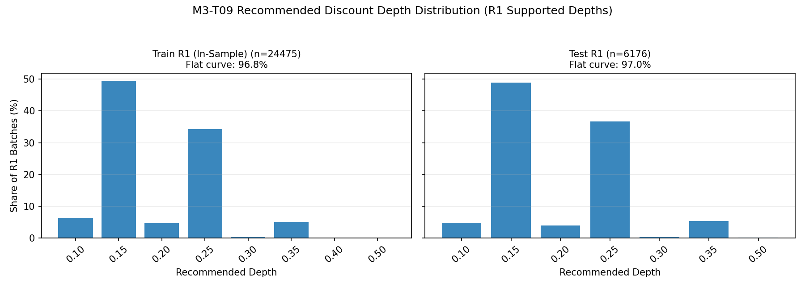

# M3-T09: Track 3C What-If Scoring & Discrete Discount Optimizer Report

**Task:** M3-T09 — Track 3C What-If Scoring & Optimizer  
**Branch:** `M3-T09-whatif-optimizer`  
**MLflow Experiment:** `smart-shelf-3c-discount-optimizer` (Run ID: `63724d725d91460e82b41f37da04825c`)  
**Frozen Dependencies:** `models/track_3b_regressor.joblib` (CV `profit_unit_mae = $1.8337/unit`), `models/track_3b_region_support_ref.json`  
**Generated Artifacts (gitignored):** `data/processed/optimizer_recs_train.csv` (`24,475` R1 rows), `data/processed/optimizer_recs_test.csv` (`6,176` R1 rows)

---

## 1. Pre-Registered Design Decisions (D1–D4)

- **D1 — Candidate Set (Documented Deviation from Card):** The proposal/Notion card lists `{0, 10, 20, 30, 40, 50}%`. M3-T05 proved discounting follows an exact deterministic rule (`expiry_remaining_ratio <= 0.40 OR quality_grade == 'C'`), creating disjoint regions `R0` (never discounted) and `R1` (always discounted). Therefore:
  - **`R0` batches** receive **no recommendation** (`status="no_markdown_historical_practice"`, `reason="no_discount_region"`).
  - **`R1` batches** are scored over `{0.10, 0.15, ..., 0.75}` restricted strictly to depths marked `supported=True` by `discount_support()`; `0%` is never a candidate for `R1`, and no extrapolation is permitted.
- **D2 — Objective & Tie-Breaking:** Batch expected profit is $\text{initial\_quantity} \times (\hat{s} \times \text{round}(\text{base\_price} \times (1 - d), 2) - \text{cost\_price})$ via `predict_profit_curve()`. The recommendation is the supported depth with highest predicted profit; exact ties go to the shallower depth.
- **D3 — Margin & Flat-Curve Flag:** `margin_per_unit` = best minus second-best predicted profit per initial unit. `flat_curve = True` when `margin_per_unit < $1.8337` (the frozen regressor's CV `profit_unit_mae` from `models/track_3b_regressor.json`, never from test).
- **D4 — Scope:** Single, one-time markdown decision at inspection time; no multi-stage markdown trajectory.

---

## 2. Validation Results (All Passed)

| Check | Result |
| :--- | :--- |
| **2a. Bounds & Region Guards** | `25/25` `R0` test rows returned `status="no_markdown_historical_practice"`, `reason="no_discount_region"`, `NaN` depth; 100% of `R1` recommendations in `[0.10, 0.75]` and `!= 0%`. |
| **2b. Profit Identity (1,000 random cells)** | Max absolute error = **`0.00e+00`**. |
| **2c. Determinism & Single-Row Parity** | `optimize_batches(b5.iloc[[0]])` equals `optimize_batches(b5).iloc[[0]]`; repeated calls are bit-for-bit identical. |
| **2d. Candidate Support Coverage** | **`0`** `R1` rows had zero supported depths (`train=0`, `test=0`). |

---

## 3. Descriptive Output (No Performance Claims)

*Note: Training `R1` recommendations are in-sample (used only to describe the distribution and derive tiers in M3-T10).*

### 3.1 Recommended Depth Distribution & `flat_curve` Share

| Metric | Train `R1` (`N = 24,475`) | Test `R1` (`N = 6,176`) |
| :--- | :---: | :---: |
| `0.10` / `0.15` / `0.20` / `0.25` / `0.30` / `0.35` / `0.40–0.50` | `6.2% / 49.4% / 4.7% / 34.3% / 0.3% / 5.1% / 0.04%` | `4.7% / 48.9% / 4.0% / 36.6% / 0.2% / 5.4% / 0.1%` |
| At shallowest supported depth | `78.5%` | `76.2%` |
| At deepest supported depth | `1.2%` | `1.6%` |
| `> 80%` at a single depth? | `False` (max `49.4%` at `0.15`) | `False` (max `48.9%` at `0.15`) |
| **`flat_curve` share (`margin < $1.8337/u`)** | **`96.8%`** | **`97.0%`** |
| `margin_per_unit` quantiles (`p25 / p50 / p75 / p95`) | `$0.08 / $0.25 / $0.49 / $1.39` | `$0.08 / $0.24 / $0.50 / $1.38` |

### 3.2 Comparison with Historical Actual Depth (`Test R1`, N = 6,176)

Overall: **`14.4%`** within `±0.025` of historical actual depth (`14.5%` in Train `R1`); mean signed difference (`recommended - actual`) = **`-0.1356`** (`-0.1345` in Train `R1`).

| Expiry Tercile (`R1`) | Grade Group | `n` | Mean Rec Depth | Mean Actual Depth | Mean (`Rec - Actual`) | Within `±0.025` | At Shallowest |
| :---: | :--- | :---: | :---: | :---: | :---: | :---: | :---: |
| `1` (shortest) | `Grade_AB` | 1,889 | 0.251 | 0.522 | -0.271 | 1.9% | 99.2% |
| `1` (shortest) | `Grade_C` | 322 | 0.350 | 0.614 | -0.263 | 1.6% | 99.7% |
| `2` (middle) | `Grade_AB` | 1,477 | 0.162 | 0.236 | -0.074 | 16.0% | 19.8% |
| `2` (middle) | `Grade_C` | 488 | 0.160 | 0.262 | -0.101 | 17.8% | 87.5% |
| `3` (longest) | `Grade_C` | 2,000 | 0.158 | 0.200 | -0.042 | 26.2% | 89.5% |

### 3.3 Heterogeneity Summary (`Test R1`: Expiry Tercile × Baseline `s` Tercile × Grade)

- In `Exp_Tercile_1` (short expiry), `96.6%–100%` of batches across all baseline-`s` terciles pick their shallowest supported depth (`0.25` for Grade A/B, `0.35` for Grade C, because `0.10–0.20` are unsupported there).
- In `Exp_Tercile_2 × Low_Base_s × Grade_AB` (`n = 1,045`), only `3.3%` stay at the shallowest `0.10` depth (`mean = 0.180`, `median = 0.15`), stepping up to `15–20%` to lift low baseline sell-through.
- Over `96%` of batches are flagged `flat_curve = True`, meaning the profit difference between the top two depths is smaller than the regressor's CV MAE (`$1.83/unit`).

---

## 4. Limitations & Deviations from Plan

- **Limitations:**
  1. **Inherited Regressor Limits:** Observational `R1` data only, right-censoring at `s = 1`, synthetic dynamics, inability to test whether to discount at all (`0%` vs `>0%`), and no evidence-based discount for `R0` batches.
  2. **Conservative `flat_curve` Threshold:** The `flat_curve` threshold (CV profit-per-unit MAE of `$1.8337/unit`) is conservative because depth-to-depth profit differences for the *same* batch are much less noisy than cross-batch profit-level errors, so `97.0%` of test `R1` recommendations (`96.8%` train `R1`) are flagged as flat. This threshold was fixed in advance (D3) and not altered after seeing results.
  3. **Support-Driven Clustering:** Clustering at the shallowest supported depth (`76.2%` test `R1`, `78.5%` train `R1`) is partly caused by region support limits—for `R1` expiry tercile 1, the shallowest supported depth is `0.25` (Grade A/B) or `0.35` (Grade C)—not solely by the model's preference.
  4. **Deeper Discounts Rarely Pay for Themselves Inside `R1`:** Under the frozen regressor, deeper discounts almost never pay for themselves inside `R1` because the estimated sell-through gain per unit of discount (`+2.2` to `+2.6` pts per `+10%` discount) is far smaller than the margin lost on already-high baseline sell-through.
- **Deviations from Plan:** (1) Candidate set is `R1`-only `{0.10, ..., 0.75}` filtered by `discount_support()`, rather than `{0, 10, 20, 30, 40, 50}%` across all batches (D1); (2) single-stage markdown decision only (D4).
