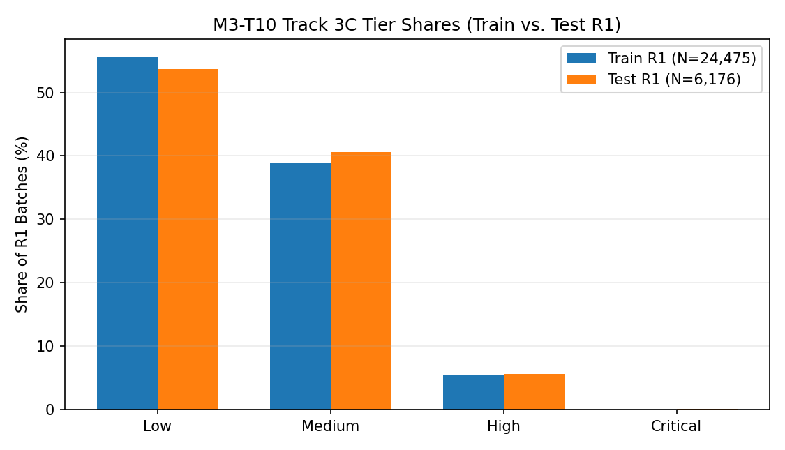
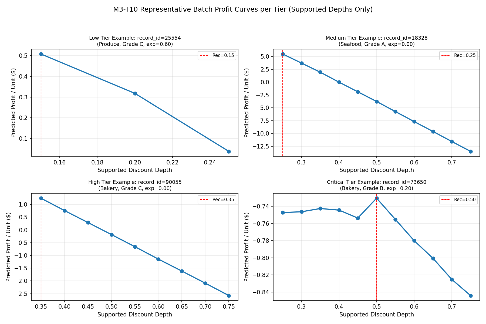

# M3-T10: Track 3C Tier Mapping for the Dashboard Report

**Task:** M3-T10 — Track 3C Tier Mapping  
**Branch:** `M3-T10-tier-mapping`  
**MLflow Experiment:** `smart-shelf-3c-discount-optimizer` (Run ID: `4774b6f6e1c04181ac7a5441bf22c828`)  
**Frozen Edges Artifact:** `models/track_3c_tier_edges.json` (`source_sha256 = 13156946339ac9c5d7ffb3b3f3e569083a5c25185b3f0341b9fb54a3d7a5afd2`)

---

## 1. Pre-Registered Rule (T-Edges)

Let $F(d)$ be the cumulative share of training `R1` recommendations (`N = 24,475`) with `recommended_depth <= d`:
- **`Edge1`** = smallest $d$ with $F(d) \ge 0.50$
- **`Edge2`** = smallest $d$ with $F(d) \ge 0.80$
- **`Edge3`** = smallest $d$ with $F(d) \ge 0.95$
- **Tiers:** `Low` ($d \le \text{Edge1}$), `Medium` ($\text{Edge1} < d \le \text{Edge2}$), `High` ($\text{Edge2} < d \le \text{Edge3}$), `Critical` ($d > \text{Edge3}$).
- **`R0` Batches:** Not assigned a tier; status is **`"No markdown (historical practice)"`**.

---

## 2. Derived Edges & Train vs. Test Shares

- **Derived Edges (Training `R1` only):** `Edge1 = 0.15` ($F = 55.64\%$), `Edge2 = 0.25` ($F = 94.57\%$), `Edge3 = 0.35` ($F = 99.96\%$). All 4 tiers are distinct and non-empty.

| Tier | Depth Range | Train `R1` Count (Share) | Test `R1` Count (Share) | Diff (Test − Train) | Test `< 20` Flag? |
| :--- | :---: | :---: | :---: | :---: | :---: |
| **Low** | `0.10 – 0.15` | 13,617 (`55.64%`) | 3,316 (`53.69%`) | `-1.94%` | No |
| **Medium** | `0.20 – 0.25` | 9,529 (`38.93%`) | 2,508 (`40.61%`) | `+1.68%` | No |
| **High** | `0.30 – 0.35` | 1,319 (`5.39%`) | 346 (`5.60%`) | `+0.21%` | No |
| **Critical** | `0.40 – 0.50` | 10 (`0.04%`) | 6 (`0.10%`) | `+0.06%` | **Yes (`6 < 20`)** |

---

## 3. Per-Tier Training Documentation (`N = 24,475`)

| Tier | Depths | Median Pred Profit/Unit | `flat_curve` Share | Median Historical Depth | Composition (`R1` Expiry Tercile × Grade) |
| :--- | :---: | :---: | :---: | :---: | :--- |
| **Low** | `0.10–0.15` | `+$1.29` | `94.5%` | `0.21` | `T2_AB: 4,305; T2_C: 1,943; T3_C: 7,369` |
| **Medium** | `0.20–0.25` | `+$0.44` | `99.8%` | `0.47` | `T1_AB: 7,196; T2_AB: 1,349; T2_C: 234; T3_C: 750` |
| **High** | `0.30–0.35` | `-$0.23` | `99.0%` | `0.60` | `T1_AB: 48; T1_C: 1,185; T2_AB: 79; T2_C: 7` |
| **Critical** | `0.40–0.50` | `-$6.27` | `100.0%` | `0.30` | `T1_AB: 9; T2_AB: 1` |

---

## 4. Representative Example Batches (Closest to Tier Median)

Selected deterministically by minimum standardized Euclidean distance to each tier's median `(expiry_remaining_ratio, oof_proba, recommended_depth)` (ties broken by lowest `record_id`):

| Tier | `record_id` | Category (Grade) | `expiry_remaining_ratio` | `oof_proba` | Rec Depth | `flat_curve` | Supported Curve Peak |
| :--- | :---: | :--- | :---: | :---: | :---: | :---: | :--- |
| **Low** | `25554` | `Produce` (`C`) | `0.600` | `0.240` | `0.15` | `True` | Peaks at `0.15` (`+$1.47/u` vs `+$1.37/u` at `0.10`) |
| **Medium** | `18328` | `Seafood` (`A`) | `0.000` | `0.206` | `0.25` | `True` | Shallowest supported `0.25` (`-$0.19/u`, declines monotonically to `0.75`) |
| **High** | `90055` | `Bakery` (`C`) | `0.000` | `0.283` | `0.35` | `True` | Shallowest supported `0.35` (`-$0.62/u`, declines monotonically to `0.75`) |
| **Critical** | `73650` | `Bakery` (`B`) | `0.200` | `0.198` | `0.50` | `True` | Peaks at `0.50` (`-$5.72/u` vs `-$5.81/u` at `0.25`) |

---

## 5. Dashboard Plain-Language Wording (`TIER_WORDING` in `src/m3_t10_tiers.py`)

- **`Low`:** `"Low: a shallow markdown of about 10-15% is recommended."`
- **`Medium`:** `"Medium: a moderate markdown of about 20-25% is recommended."`
- **`High`:** `"High: a deeper markdown of about 30-35% is recommended."`
- **`Critical`:** `"Critical: a deep markdown above 35% is recommended."`
- **`R0` (`No markdown (historical practice)`):** `"No markdown recommended: this batch is outside the range where the data supports a discount decision."`

---

## 6. Validation, Limitations & Deviations from Plan

- **Validation (All Passed):** `assign_tier()` is monotone across `{0.10..0.75}`; single-row equals batch output; `track_3c_tier_edges.json` reloads identically; 100% of `R1` rows receive exactly one tier; `R0` rows receive `tier=None` and `"No markdown (historical practice)"`.
- **Limitations:**
  1. Tiers describe **recommended markdown depth**, not spoilage risk.
  2. Most recommendations cluster at `10–35%` partly due to support limits (`0.25` / `0.35` shallowest in `T1`) and because the regressor finds deeper discounts rarely pay inside `R1`.
  3. The `Critical` tier is tiny (`10` training rows, `6` test rows `< 20`) and should be treated as rare/edge-case in UI reporting.
  4. Tiers inherit all Track 3B regressor limits (observational `R1` data, censoring at `s = 1`, synthetic data).
- **Deviations from Plan:** `R0` batches are excluded from tiering (`"No markdown (historical practice)"`) rather than assigned to `Low`/`No Action` under a unified 0%–50% grid.
