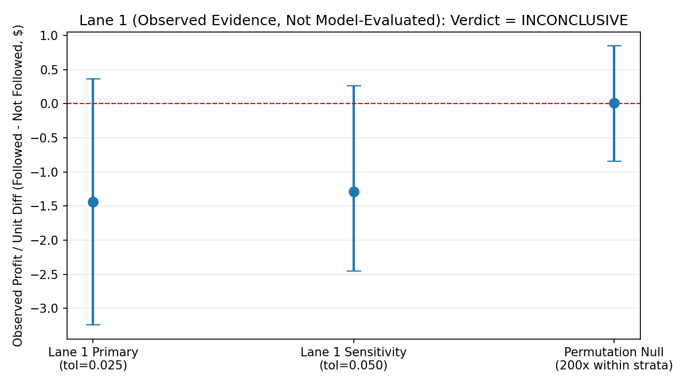
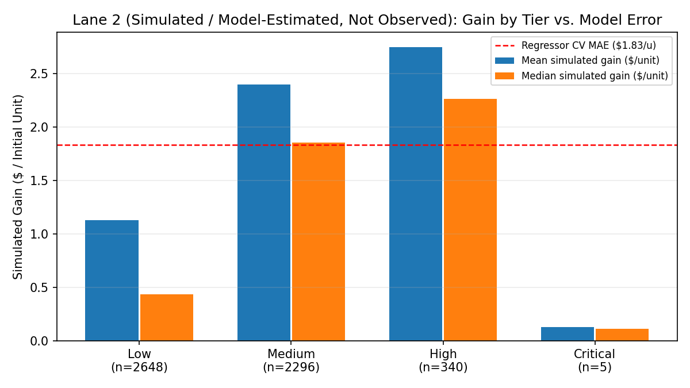

# M3-T11: Track 3C Two-Lane Optimizer Validation Report

**Task:** M3-T11 — Lane 1 (Observed Evidence) & Lane 2 (Simulated Counterfactual) Validation  
**Branch:** `M3-T11-two-lane-validation`  
**MLflow Experiment:** `smart-shelf-3c-discount-optimizer` (Run ID: `b62e8893e1b9490db3176f715c576c19`)  
**Hard Rule:** Lane 1 and Lane 2 are strictly separated and never summed, averaged, or blended.

---

## 1. Scope Statement

The system evaluates a single, one-time markdown decision at the point a batch is inspected. It does not model a multi-stage markdown trajectory. Batches in region `R0` receive no recommendation (historical practice: no markdown) and are excluded from both lanes; their count and share are reported as the portion of the business the optimizer does not address.

---

## 2. Pre-Registered Design (Fixed Before Results)

- **Population:** Test `R1` rows (`N = 6,176`). Test `R0` rows (`N = 13,782`, `69.06%`) are excluded from both lanes.
- **Lane 1 (Observed Evidence, No Model Grading Itself):** Compares `followed` (`|actual - rec| <= 0.025`; sensitivity `<= 0.05`) vs. `not_followed` within `expiry_remaining_ratio tercile × grade group (C vs AB) × oof_proba tercile` strata (edges from training `R1` only), including only strata with $\ge 20$ followed AND $\ge 20$ not-followed test batches. Estimate is the stratum-size-weighted mean difference (`followed - not_followed`) with a 1,000-resample week-grouped bootstrap 95% CI. Decision rule: `"supports the optimizer"` if profit/unit CI $> 0$; `"inconclusive"` if it contains $0$; `"contradicts"` if $< 0$; `"underpowered"` if $< 300$ followed batches remain. Negative control: 200 within-stratum permutations of `recommended_depth`.
- **Lane 2 (Simulated / Model-Estimated, Not Observed):** On test `R1` batches where `|actual - rec| > 0.025`, computes frozen Track 3B regressor predicted profit at `recommended_depth` minus predicted profit at the nearest supported grid point to `actual_depth`, alongside the regressor's actual-depth error (`MAE`, `RMSE`, mean error) on the same batches.

---

## 3. Integrity Checks & Portion of Business Not Addressed

- **Test Region Rule Violations:** `0` across all `19,958` test rows.
- **Portion Not Addressed (`R0`):** **`13,782 / 19,958` (`69.06%`)** of test batches lie in `R0` (`expiry_remaining_ratio > 0.40` and `grade != 'C'`) and receive no markdown recommendation.
- **Test `R1` (`6,176`, `30.94%`):** `0` `R0` rows appear in either lane; `100%` of `R1` batches have supported recommendations.

---

## 4. Lane 1 — Observed Evidence (Followed vs. Not Followed)

### 4.1 Coverage & Strata Table (`tol = 0.025`)
- **Included:** **`8 / 15` populated strata**, covering **`4,841 / 6,176` (`78.4%`)** of test `R1` (`849` followed, `3,992` not followed).
- **Excluded (`7` strata, `1,335` batches):** All excluded for having `< 20` followed batches. *(Per-stratum counts are stored in `m3_t11_results_summary.json`; per-stratum point estimates are not stored separately.)*

| Stratum (`Expiry_Grade_Risk`) | Total | Followed (`<=0.025`) | Not Followed | Status |
| :--- | :---: | :---: | :---: | :---: |
| `E1_GAB_R1` | 1,013 | 22 | 991 | Included |
| `E1_GAB_R2` | 603 | 11 | 592 | Excluded (`<20` followed) |
| `E1_GAB_R3` | 273 | 3 | 270 | Excluded (`<20` followed) |
| `E1_GC_R1` | 1 | 0 | 1 | Excluded (`<20` followed) |
| `E1_GC_R2` | 57 | 2 | 55 | Excluded (`<20` followed) |
| `E1_GC_R3` | 264 | 3 | 261 | Excluded (`<20` followed) |
| `E2_GAB_R1` | 923 | 146 | 777 | Included |
| `E2_GAB_R2` | 421 | 72 | 349 | Included |
| `E2_GAB_R3` | 133 | 18 | 115 | Excluded (`<20` followed) |
| `E2_GC_R1` | 4 | 1 | 3 | Excluded (`<20` followed) |
| `E2_GC_R2` | 142 | 22 | 120 | Included |
| `E2_GC_R3` | 342 | 64 | 278 | Included |
| `E3_GC_R1` | 180 | 51 | 129 | Included |
| `E3_GC_R2` | 869 | 222 | 647 | Included |
| `E3_GC_R3` | 951 | 250 | 701 | Included |

### 4.2 Lane 1 Estimates, Sensitivity & Negative Control

| Outcome (`Followed − Not Followed`) | Point Estimate | 95% Week-Grouped Bootstrap CI |
| :--- | :---: | :---: |
| **Observed Profit / Initial Unit ($)** | **`-$1.4421`** | **`[-$3.2437, +$0.3666]`** |
| Observed Sell-Through `s` | `-0.1169` | `[-0.1353, -0.0976]` |
| Observed Waste Share (`units_wasted / init_qty`) | `+0.1169` | `[+0.0976, +0.1353]` |
| Observed Batch Profit ($) | `-$163.33` | `[-$802.82, +$436.42]` |

- **Lane 1 Verdict (`tol = 0.025`):** **`inconclusive`** (`849` followed $\ge 300$, and the profit/unit 95% CI contains `$0.00`). Plainly: the point estimate is negative (`-$1.4421/unit`); the sell-through (`-0.117`) and waste-share (`+0.117`) effects are precisely estimated and agree in direction with the positive demand slope from M3-T05/T07 (shallower discounts sell fewer units and leave more waste); and **the data provide no support for the claim that following the recommendation raised observed profit**.
- **Sensitivity (`tol = 0.050`, `9/15` strata, `1,865` followed):** Profit/unit diff = `-$1.2846` (`95% CI [-$2.4503, +$0.2602]`) — also **`inconclusive`**.
- **Negative Control (`200` within-stratum permutations):** This check performs an unclustered within-stratum permutation that ignores clustering by week and heavy profit tails (null mean = `+$0.0089`, `SD = $0.4381`, `95% [-$0.8409, +$0.8472]`, real `-$1.4421`, `p = 0.000`). Because it ignores week-level clustering and heavy tails, its p-value is not directly comparable with the week-grouped bootstrap CI. As a **hypothesis** (untested here), the gap between the real estimate and the permutation null may reflect residual within-stratum selection because the strata are coarse terciles.
- **Supporting Observed Depth-Band View (Example `E2_GAB_R1`, no model):** Observed mean profit/unit rises from `-$0.22` (`10-15%`, `n=155`) to `+$0.05` (`15-20%`, `n=171`) and `+$0.07` (`20-25%`, `n=179`), then falls to `-$0.43` (`25-30%`), `-$1.20` (`30-35%`), and `-$2.27` (`40-45%`).

---

## 5. Lane 2 — Simulated / Model-Estimated, Not Observed (`N = 5,289`)

*All figures and numbers in this section are **simulated / model-estimated, not observed**.*

- **Simulated Gain vs. Model Error:** Mean simulated gain is **`+$1.7838/unit`** (`95% CI [+$1.6850, +$1.8705]`, median **`+$0.7026/unit`**; batch mean **`+$458.87`**, CI `[+$431.19, +$481.67]`, median `+$158.42`). However, **`70.1%` of simulated gains are smaller than the regressor's CV profit-per-unit MAE (`$1.8337/unit`)**, and on these same batches at their actual (nearest-supported) depth, the regressor's own prediction error is **`MAE = $1.60/unit`**, **`RMSE = $5.97/unit`**, mean error (`pred - obs`) = **`+$0.07/unit`** (mean snap distance `0.0119`).
- **Share with Positive Simulated Gain:** `100.0%` (by construction of argmax over supported depths).

| Breakdown Group | `n` | Mean Sim Gain/Unit | Median Sim Gain/Unit | Mean Sim Gain/Batch |
| :--- | :---: | :---: | :---: | :---: |
| **Tier: `Low`** | 2,648 | `+$1.13` | `+$0.43` | `+$295.04` |
| **Tier: `Medium`** | 2,296 | `+$2.40` | `+$1.86` | `+$611.25` |
| **Tier: `High`** | 340 | `+$2.75` | `+$2.27` | `+$712.60` |
| **Tier: `Critical`** | 5 | `+$0.13` | `+$0.11` | `+$3.19` |
| **`flat_curve = True`** | 5,151 | `+$1.52` | `+$0.67` | `+$389.16` |
| **`flat_curve = False`** | 138 | `+$11.62` | `+$10.36` | `+$3,060.87` |

---

## 6. Reading the Two Lanes Together

Lane 1 and Lane 2 evaluate different batches (`4,841` in-strata batches vs. `5,289` non-followed batches) and answer different questions (observed historical contrast vs. model-simulated counterfactual), and are never combined. Crucially, the observed Lane 1 evidence (`-$1.44/unit`, inconclusive) **does not corroborate** Lane 2's simulated gain (`+$1.78/unit`). Possible reasons—stated strictly as **untested hypotheses**—include: (a) regressor error at shallow depths (`70.1%` of simulated gains are below the `$1.83/unit` CV MAE), (b) right-censoring at `s = 1`, (c) residual within-stratum confounding, (d) heterogeneity across strata, and (e) heavy-tailed batch profit.

---

## 7. What Can and Cannot Be Claimed

> **What Can and Cannot Be Claimed**
> - **CAN Claim:** The optimizer is an **advisory decision-support tool for `R1` batches** (`30.94%` of test); the positive demand-response direction inside `R1` is supported by observed data (M3-T05/T07); and **`R0` (`69.06%` of test batches) is outside the optimizer's scope**.
> - **CANNOT Claim:** **Proven profit lift** (Lane 1 is inconclusive with negative point estimate); **any combined improvement percentage** across lanes; or **any evidence about whether to discount at all** (`0%` vs. `>0%`).

---

## 8. Limitations & Deviations from Plan

- **Limitations:** (1) Observational data; hidden confounders cannot be excluded. (2) Lane 1 covers a non-random subset (`8/15` strata). (3) Lane 2 is self-evaluated by the regressor and expected to look favorable. (4) Heavy censoring at `s = 1`. (5) Synthetic data. (6) `97%` of recommendations lie on flat curves.
- **Deviations from Plan:** (1) Lane 1 reframed as `followed` vs. `not_followed` because matched batches have identical depth by construction. (2) `R0` (`69.06%`) excluded from both lanes. (3) Candidate grid uses supported `R1` depths `{0.10..0.75}` rather than `{0, 10..50}%`.
