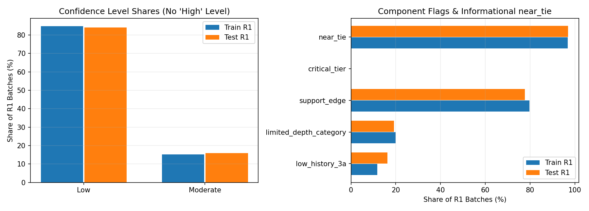
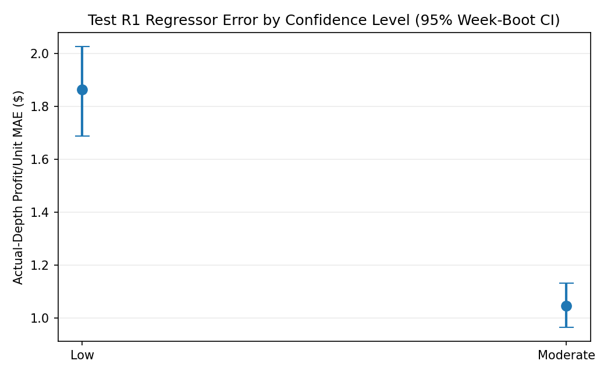

# M3-T12: Track 3C Confidence Propagation Report

**Task:** M3-T12 — Weakest-Link Confidence Propagation  
**Branch:** `M3-T12-confidence-propagation`  
**MLflow Experiment:** `smart-shelf-3c-discount-optimizer` (Run ID: `2143aa1328194920b3293b121d7ca2d8`)  
**Output Files (gitignored):** `data/processed/optimizer_recs_with_confidence_train.csv` (`24,475` rows), `data/processed/optimizer_recs_with_confidence_test.csv` (`6,176` rows, SHA-256 `2B62BBAE...`)

---

## 1. Pre-Registered Rules & Why There Is No "High" Level

- **Confidence Levels:** `"No recommendation"` (`R0`), `"Low"`, `"Moderate"`. There is **deliberately no `"High"` level** because Lane 1 observed validation was inconclusive (`-$1.44/unit`, CI `[-$3.24, +$0.37]`) and `70.1%` of Lane 2 simulated gains sit below the regressor's CV MAE (`$1.8337/unit`).
- **Component Flags (`R1`):**
  - **`F3A` (`low_history_3a`):** `product_name × store_id` `< 20` training rows (`src/support.py`). Data-sparsity flag ("limited history for this product at this store"), not demonstrated model miscalibration.
  - **`F3B1` (`limited_depth_category`):** Category has `< 8` of 13 depth bands with `>= 30` training `R1` rows (`Beverages`, `Dairy`, `Frozen_Meals`, `Pharmaceuticals`), computed in code without reading `reports/tables/`.
  - **`F3B2` (`support_edge`):** Recommended depth equals the shallowest or deepest supported depth for that batch.
  - **`F3B3` (`critical_tier`):** `tier == "Critical"` (`< 20` test batches).
  - **`INFO` (`near_tie`):** `flat_curve` (informational only; NOT used for `confidence_level`).
- **Weakest-Link Combination:** `Low` if **any** of `{F3A, F3B1, F3B2, F3B3}` is `True`; otherwise `Moderate`; `R0` = `No recommendation`.
- **Global Caveat (shown with every recommendation):** *"Advisory estimate. The observed-data backtest was inconclusive; see the validation report."*

---

## 2. Validation & Propagation Checks (All Passed)

- Weakest-link property verified (adding any true flag on a `Moderate` row forces `Low`; never raises level).
- Zero rows labeled `"High"`; `100%` of `R0` rows labeled `"No recommendation"`; `100%` of `R1` rows receive `Low` or `Moderate`.
- Single-row `attach_confidence()` matches batched output bit-for-bit; two runs produce identical SHA-256 hashes (`2B62BBAE284ED010C70A14C959D7E94DBCC400F7DF7D0ABC50866A11E5370894`).

---

## 3. Confidence Distributions & Flag Overlap (`Train R1` vs. `Test R1`)

| Metric | Train `R1` (`N = 24,475`) | Test `R1` (`N = 6,176`) |
| :--- | :---: | :---: |
| **`Low`** | `84.78%` (`20,750`) | **`84.12%` (`5,195`)** |
| **`Moderate`** | `15.22%` (`3,725`) | **`15.88%` (`981`)** |
| `F3A` (`low_history_3a`) | `11.77%` | `16.35%` |
| `F3B1` (`limited_depth_category`) | `19.99%` | `19.28%` |
| `F3B2` (`support_edge`) | `79.77%` | `77.75%` |
| `F3B3` (`critical_tier`) | `0.04%` | `0.10%` |
| `INFO` (`near_tie`) | `96.80%` | `96.97%` |

- **Pairwise Flag Overlap (`Test R1`):** `limited_depth_category & support_edge` = `16.55%`; `low_history_3a & support_edge` = `12.58%`; `low_history_3a & limited_depth_category` = `1.80%`; `low_history_3a & critical_tier` = `0.03%`; `limited_depth_category & critical_tier` = `0.02%`. Active flags per row: `0` (`981`), `1` (`3,480`), `2` (`1,616`), `3` (`99`).
- **By Tier (`Test R1`):** `Moderate` share is `18.9%` (`Low` tier), `13.3%` (`Medium`), `5.5%` (`High`), `0.0%` (`Critical`).
- **By Category & Expiry × Grade (`Test R1`):** `Beverages`, `Dairy`, `Frozen_Meals`, `Pharmaceuticals` are `100% Low`; `Deli` (`26.2%`) and `Meat` (`26.5%`) have the highest `Moderate` shares. `Moderate` batches sit primarily in `Exp_Tercile_2 × Grade_AB` (`62.4%` Moderate; `60.6%` in train).

---

## 4. Descriptive Error-by-Level Check (`Test R1` Actual Depth)

| Confidence Level | `n` | Profit/Unit MAE (95% Week-Boot CI) | Profit/Unit RMSE (95% CI) | Sell-Through `s` MAE | Observed Profit/Unit Mean |
| :--- | :---: | :---: | :---: | :---: | :---: |
| **`Low`** | 5,195 | **`$1.86`** (`[$1.69, $2.03]`) | **`$6.92`** (`[$6.11, $7.58]`) | `0.1087` | `-$1.63` |
| **`Moderate`** | 981 | **`$1.04`** (`[$0.96, $1.13]`) | **`$1.48`** (`[$1.34, $1.63]`) | `0.1051` | `-$0.76` |

**Finding:** **`Low` confidence batches genuinely have substantially higher profit-per-unit model error than `Moderate` batches** (`$1.86` vs. `$1.04` MAE; `$6.92` vs. `$1.48` RMSE, non-overlapping 95% CIs), even though `s` MAE is similar (`0.1087` vs. `0.1051`), because `Low` batches include higher-price/tail `limited_depth_category` and `support_edge` items.

---

## 5. Dashboard Wording (`CONFIDENCE_WORDING` in `src/m3_t12_confidence.py`)

- **Levels:** `No recommendation` (*"No markdown recommended: this batch is outside the range where the data supports a discount decision."*), `Low` (*"Low confidence: one or more data-support limits apply to this recommendation; treat as a tentative estimate."*), `Moderate` (*"Moderate confidence: this batch lies inside supported data ranges, but remains an advisory model estimate rather than a guarantee."*).
- **Reasons:** `low_history_3a` (*"Limited history for this product at this store (fewer than 20 training rows)."*), `limited_depth_category` (*"Category has limited historical discount-depth coverage (fewer than 8 of 13 depth bands supported)."*), `support_edge` (*"Recommended depth sits on the shallowest or deepest supported depth boundary for this batch."*), `critical_tier` (*"Critical tier has very thin historical support (fewer than 20 test batches)."*), `near_tie` (*"Predicted profit is nearly the same across depths."*).

---

## 6. Limitations & Deviations from Plan

- **Limitations:** (1) Flags measure data support, not guaranteed correctness; (2) the 3A `low_history_3a` flag showed no measurable calibration difference; (3) `flat_curve` (`near_tie`) uses a conservative threshold and is informational only; (4) `Moderate` is not a performance guarantee; (5) synthetic data.
- **Deviations from Plan:** No `"High"` confidence level exists by pre-registered design; `limited_depth_category` is computed directly from `model_ready_3b_dataset.csv` rather than reading `reports/tables/M3_T08_category_elasticity.csv`.
